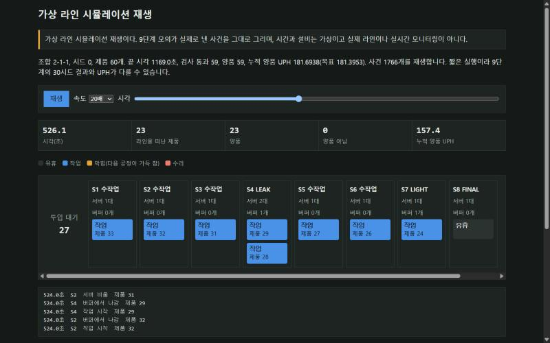

# 가상 조립·검사 공정의 진행 조건 판정기

## 바로 보기: 가상 라인 시뮬레이션

[](https://wnscks555-glitch.github.io/sl-kdt-ai-project/reports/line_replay.html)

**[▶ 시뮬레이션 화면 열기](https://wnscks555-glitch.github.io/sl-kdt-ai-project/reports/line_replay.html)** (설치 없이 브라우저에서 바로 열립니다)

작업장 8곳(S1~S8)으로 이루어진 가상 조립·검사 라인에 제품 60개를 흘려보내고, 각 작업장이 언제 일하고 언제 쉬는지, 어디서 제품이 밀리는지를 시간 순서대로 다시 보여 주는 화면입니다. 재생 버튼을 누르거나 시간 막대를 움직이면 라인이 돌아가는 모습을 볼 수 있습니다. 시간과 설비는 모두 가상입니다.

## 처음 보시는 분께 (3분 요약)

**한 줄 소개.** 자동차 램프를 조립하고 검사하는 공장 라인을 컴퓨터 안에 가상으로 만들고, 불량품을 어떻게 걸러내고 설비를 언제 멈출지 정하는 기준을 세운 뒤, 그 기준이 실제로 잘 맞는지 숫자로 확인한 개인 프로젝트입니다.

**왜 했나.** 생산 현장에서는 불량이 나왔을 때 제품을 다시 검사할지, 버릴지, 설비를 멈출지를 정해진 기준으로 판단합니다. 그 기준을 직접 세워 보고, 기준이 맞는지 결과로 검증하는 과정을 연습하고 싶었습니다.

**작성자가 한 일과 AI가 한 일.**
- 작성자: 판정 기준과 정지 기준 결정, 결과를 보기 전에 정답표(사전 기대표) 확정, AI 검수 결과를 의심하고 검수 기준 강화, 단계별 결과 확인과 승인
- AI 코딩 도구(Codex, Claude Code): 코드 대부분 작성. 한 도구가 만들면 다른 도구가 검수하도록 역할을 나눔

**대표 결과 (모두 가상 데이터 기준).**

| 확인한 것 | 결과 |
| --- | --- |
| 불량품을 제대로 걸러내는가 | 가상 제품 500개 중 결함품 6개를 모두 걸러냄(폐기 4개, 보류 2개), 정상품은 하나도 버리지 않음 |
| 검수 결과를 믿어도 되는가 | AI 검수가 4번 연속 문제없음이라고 했지만 그대로 믿지 않고 검수 기준을 높여, 놓친 문제 6건(중요 1건, 보통 5건)을 찾아 고침 |
| 설비를 언제 멈춰야 하는가 | 설비 정지 규칙 6가지를 결과를 보기 전에 정한 기준으로 비교해, 최근 3건 중 2건이 불합격이면 멈추는 규칙을 고름. 고장 설비는 모두 잡았지만 정상 설비도 자주 멈추는 한계가 있어 그대로 기록 |
| 라인에 작업을 어떻게 나눌까 | 목표 생산량에서 제품 1개당 허용 시간(약 19.8초)을 계산해 작업을 작업장 8곳에 나누고, 검사기 대수 조합을 비교해 목표를 맞추는 가장 작은 조합을 고름 |

**이 프로젝트에서 배운 것.** 기준은 세우는 것으로 끝나지 않고 결과로 다시 확인해야 합니다. 결과가 기대에 못 미쳐도 기준을 바꾸지 않고 한계로 기록했습니다.

**꼭 알아 두실 점.** 모든 데이터는 직접 만든 가상 데이터이고, PLC와 설비도 소프트웨어로 흉내 낸 것입니다. 실제 공장 경험이나 실제 회사 기준이 아닙니다. 수치는 가정한 조건 안에서만 의미가 있습니다.

### 단계별로 무엇을 했나 (쉬운 설명)

| 단계 | 쉬운 설명 |
| --- | --- |
| 1–4 | 조립된 제품이 검사를 통과했는지 판정하고, 다시 검사할지 버릴지, 불량이 몰리면 설비를 멈출지 정하는 규칙 |
| 5–6 | 설비를 멈추는 규칙 여러 개를 비교하고, 설비가 멈췄을 때 이미 지나간 제품을 어디까지 다시 볼지 비교 |
| 7a, 12, 13 | 측정값이 얼마나 일정한지, 측정기를 믿을 수 있는지, 공정이 평소와 달라졌는지 알려 주는 관리 방법 비교 |
| 8 | 불량이 생길 수 있는 곳과 그 영향을 미리 표로 정리하는 위험 분석 연습 |
| 9, 16 | 작업을 작업장에 나누고 배치를 그려 보는 연습, 목표 생산량을 맞추려면 설비가 얼마나 빨라야 하는지 거꾸로 계산 |
| 10 | 공장 자동화 제어기(PLC)가 신호를 읽고 설비를 움직이는 순서를 컴퓨터로 흉내 |
| 11, 14 | 이상 신호를 찾는 방법을 시험하고, 이상 발생부터 정지, 복구, 문제 제품 격리까지 한 번에 추적 |
| 15, 18 | 결과를 한 화면에서 보는 대시보드와 라인의 움직임을 다시 보여 주는 화면 |
| 17 | 공개된 실제 반도체 공정 자료로 가상 데이터의 가정이 너무 단순하지 않은지 점검 (불량 검출 성능이 아님) |

### 용어 풀이

- **재검사, 보류, 폐기:** 불합격품을 바로 버리지 않고 잠시 세워 두거나(보류) 한 번 더 검사하고(재검사), 그래도 불합격이면 버립니다(폐기).
- **설비 정지 규칙:** 최근 검사에서 불합격이 몰리면 설비 이상을 의심해 멈추는 기준입니다.
- **사전 기대표:** 프로그램을 만들기 전에 상황별 정답을 먼저 적어 둔 표입니다. 결과를 본 뒤 정답을 바꾸지 못하게 하려는 것입니다.
- **홀드아웃:** 기준을 고를 때 쓰지 않은 별도 데이터로 한 번 더 확인하는 방법입니다.
- **택트타임:** 목표 생산량을 맞추려면 제품 1개를 몇 초 안에 만들어야 하는지 나타낸 시간입니다.
- **PLC:** 공장 설비를 자동으로 움직이는 제어 장치입니다.
- **Cpk, Gage R&R, SPC 관리도, PFMEA:** 각각 공정이 규격 안에서 얼마나 안정적인지, 측정기가 믿을 만한지, 공정이 평소와 달라졌는지, 불량 위험을 미리 따져 보는 품질 관리 도구입니다.

라인 시뮬레이션 화면은 맨 위 링크로 바로 볼 수 있습니다. 아래부터는 개발자용 기술 설명입니다.

---

제품별 등록·조립 이벤트와 점등(`LIGHT`)·누설(`LEAK`) 검사 결과를 CSV로 받아, 다음 단계 진행 가능 여부와 거절 이유를 판정하는 Python CLI입니다. 현행 명세와 사전 기대표 v1(T1–T10)·v2 1단계(T11–T22)·2단계(T23–T32)는 [handoff/tasks.md](handoff/tasks.md)에 있습니다. `docs/`의 문서는 이전 범위의 기록입니다.

아래 기본 실행과 5열 입력 설명은 동결된 v1입니다. 모델별 레시피를 사용하는 v2는 뒤의 「v2 1단계: 모델별 레시피」에서 설명합니다.

모든 공정 순서와 검사 조건은 **교육용 가상 규칙이며 SL 실제 기준이 아닙니다.** 점등·누설 결과는 실측값이 아닌 합성 `PASS`/`FAIL` 입력입니다. **「선택한 두 검사까지의 모의 흐름 완료」는 출하·양품·SL 기준 적합을 뜻하지 않습니다.**

## 기술 요약 (단계별 결과)

조립·검사 공정을 합성 데이터로 모의해, 판정 규칙이 맞는지와 검사·정지 기준이 얼마나 듣는지를 수치로 확인하는 연습 프로젝트입니다. 실제 설비, 실제 라인, SL 기준이 아닙니다.

코드는 대부분 AI 코딩 도구(Codex, Claude Code)가 작성했고, 판정 규칙과 사전 기대표, 결과 승인은 작성자가 맡았습니다. **1–18단계 결과는 모두 작성자가 확인하고 승인했습니다.**

결과는 [`reports/dashboard.html`](reports/dashboard.html)을 브라우저로 열면 탭 8개로 볼 수 있습니다.

| 단계 | 내용 | 사전 기준 결과 |
| --- | --- | --- |
| 1–4 | 공정 진행 판정, 모델별 레시피, 재검사, 3:2 설비 정지 | 기대표 통과 |
| 5–6 | 정지 규칙 평가, 격리 범위 평가 | 5단계 3:2 선택·확인, 6단계 기준 충족 방식 없음 |
| 7a | 측정값 판정, Cpk·Ppk | 기준 없음, 수치 보고 |
| 8 | 합성 공정 PFMEA 연습 | PF-01 충족, PF-02·PF-06 미충족, S·O·D는 사람이 매김 |
| 9 | 라인 밸런싱, 레이아웃 도식 | 조합 2-1-1, 홀드아웃 확인 |
| 10 | Python PLC 스캔 모의, 소프트웨어 간 Modbus TCP | 시나리오 8개 재현 |
| 11 | 합성 이상 검출 | `logistic`, 홀드아웃 확인, 학습 수렴 미달 공개 |
| 12 | 합성 Gage R&R, 가드밴드 | 세 게이지 모두 가드밴드 확인, %GRR은 13.4–64.6 |
| 13 | SPC 관리도 비교 | 기준 충족 관리도 없음 |
| 14 | 평균 이동 → 경보 → PLC 정지 → 복구 → 격리 → PFMEA 추적 | 선택 없음, 표로 비교 |
| 15 | 단일 HTML 대시보드 | 표시 전용 |
| 16 | 설비 요구 사양 역산 연습 | 개별 경계 LEAK 22.66초, LIGHT 11.11초, 수리 660초, 동시 적용은 미충족 |
| 17 | 공개 실측 자료(UCI SECOM)로 합성 가정 점검 | 한계 초과 비율 중앙값 0.0108, 순수 정규열 0.0020. 검출률이 아님 |
| 18 | 라인 시뮬레이션 재생 화면 | `reports/line_replay.html`, 사건 1,766개 |

기준을 충족하지 못한 결과도 기준을 바꾸지 않고 그대로 둡니다. 13단계가 그 예입니다. 선택 기준은 결과를 보기 전에 정했고, 홀드아웃 시드는 확인에만 씁니다. 수치는 모두 가정한 합성 분포 안에서만 뜻이 있습니다.

전체 재현 순서입니다. 이상 검출 학습 때문에 약 4분 걸립니다.

```powershell
py -m unittest discover -s tests
py -m src.msa recipes/msa_lamp.json
py -m src.anomaly recipes/anomaly_lamp.json
py -m src.spc recipes/spc_lamp.json
py -m src.station recipes/plc_station.json --scenario all
py -m src.incident recipes/incident_lamp.json
py -m src.dashboard --out reports/dashboard.html
py -m src.sizing recipes/sizing_lamp.json
py -m src.secom recipes/secom_check.json
py -m src.replay recipes/line_replay.json --out reports/line_replay.html
```

`src.secom`은 UCI SECOM 원자료가 `data/external/secom/`에 있어야 합니다. 받는 법은 v2 17단계 절에 있습니다.

작업 방식은 단계별로 다릅니다. 1–4단계는 Codex가 구현하고 Claude Code가 읽기 전용으로 검수했고, 5단계부터는 Claude Code가 구현하고 Codex가 읽기 전용으로 검수했습니다. 규칙과 기대표는 사람이 확인한 명세로 고정하고, 리뷰 지적과 처리는 `handoff/reviews/`, `handoff/gpt-log.md`에 남깁니다.

## 실행과 테스트

Python 3 표준 라이브러리만 사용하며 별도 패키지 설치가 필요 없습니다. 이 PC의 실행 환경은 Python 3.12.10이고, `python` 명령은 Microsoft Store 안내로 연결되므로 `py`를 사용합니다. 저장소 `project/`에서 실행합니다.

```powershell
py -m src.main data/sample_events.csv
py -m unittest discover -s tests
```

다른 입력은 `py -m src.main <입력CSV>`로 실행합니다. 터미널에는 행별 판정, 제품별 최종 상태·미완료 이유, 규칙별 거절 건수를 출력합니다. 파일을 읽을 수 없거나 CSV 구조가 잘못되면 오류를 표시하고 종료합니다. 개별 행의 값이 잘못된 경우에는 그 행을 거절하고 다음 행을 계속 처리합니다.

## 입력 형식

첫 행은 다음 열 이름과 순서를 사용합니다.

```csv
seq,product_id,event,inspection,result
1,EXAMPLE,REGISTER,,
2,EXAMPLE,PRE_ASSEMBLY,,
3,EXAMPLE,MAIN_ASSEMBLY,,
4,EXAMPLE,INSPECT,LIGHT,PASS
5,EXAMPLE,INSPECT,LEAK,PASS
```

- `seq`: 양의 정수인 행 표식입니다. 중복이나 비단조 증가를 허용하며, 판정은 `seq`로 정렬하지 않고 CSV에 기록된 물리적 행 순서로 진행합니다.
- `product_id`: 빈 값이나 공백만 있는 값은 거절합니다. 각 제품의 상태는 독립적으로 관리합니다.
- `event`: `REGISTER`, `PRE_ASSEMBLY`, `MAIN_ASSEMBLY`, `INSPECT` 중 하나입니다.
- `inspection`, `result`: `INSPECT`에서만 각각 `LIGHT` 또는 `LEAK`, `PASS` 또는 `FAIL`을 사용합니다. 다른 이벤트에서는 두 칸을 비웁니다.

이벤트·검사·결과 값은 위 대문자와 정확히 일치해야 합니다. 잘못된 값은 `RULE_PRESERVE`로 거절하며, 거절된 행은 제품 상태와 기존 검사 결과를 바꾸지 않습니다.

## 판정 규칙과 상태

| 규칙 ID | 의미 |
| --- | --- |
| `RULE_SEQ` | `REGISTER` → `PRE_ASSEMBLY` → `MAIN_ASSEMBLY` 순서를 지킵니다. 선행 조립 단계 없이 진행하면 거절합니다. |
| `RULE_INSP_PRE` | 본조립 완료 전 검사 입력을 거절합니다. |
| `RULE_NOT_DONE` | 본조립 후 두 검사 중 하나라도 결과가 없으면 검사 대기이며 완료할 수 없습니다. |
| `RULE_FAIL_HOLD` | 하나라도 `FAIL`이면 보류합니다. 두 검사가 모두 `PASS`일 때만 선택한 두 검사까지의 모의 흐름 완료입니다. |
| `RULE_PRESERVE` | 같은 검사에 두 번째 결과 입력, 중복 등록·조립, 미등록 제품 이벤트, 잘못된 값을 거절하고 기존 상태·결과를 보존합니다. |

제품 상태는 `등록` → `예비 조립` → `검사 대기`로 진행합니다. 본조립 뒤 검사 결과가 모두 `PASS`이면 `선택한 두 검사까지의 모의 흐름 완료`, 하나라도 `FAIL`이면 `보류`입니다. `FAIL`은 미실시 검사보다 우선하므로 다른 검사가 아직 없어도 보류입니다.

`FAIL` 뒤에도 아직 실시하지 않은 다른 검사의 최초 결과는 입력할 수 있습니다. 이미 입력한 검사 결과는 바꿀 수 없으며, 새 `PASS`를 덧붙여도 기존 `FAIL`과 보류 상태가 유지됩니다.

## 저장 보고서

현재 작업 디렉터리의 `reports/`에 다음 세 파일을 UTF-8 BOM CSV로 저장합니다. 입력이 `data/sample_events.csv`이면 파일 이름은 다음과 같습니다.

| 파일 | 열 |
| --- | --- |
| `reports/sample_events_rows.csv` | `seq,product_id,input,rule_id,decision,rejection_reason,state` — 입력별 적용 규칙, 허용·거절, 거절 이유, 처리 후 상태 |
| `reports/sample_events_products.csv` | `product_id,state,incomplete_reason` — 제품별 최종 상태와 미완료 이유 |
| `reports/sample_events_rejections.csv` | `rule_id,rejection_count` — 다섯 규칙별 거절 건수, 0건인 규칙 포함 |

파일 이름의 `sample_events`는 입력 파일의 확장자를 뺀 이름입니다. 같은 입력을 다시 실행하면 같은 파일에 덮어쓰며, 시각·난수를 판정에 사용하지 않아 터미널과 CSV 결과가 동일합니다.

## 샘플과 검증 범위

`data/sample_events.csv`는 T1–T9 상황을 제품별로 담은 고정 합성 입력입니다. T1은 정상 완료, T2는 예비 조립 누락, T3은 본조립 전 검사, T4는 `LEAK` 미실시, T5는 `LEAK FAIL`, T6은 `FAIL` 뒤 결과 덮어쓰기 시도, T7은 완료 뒤 결과 덮어쓰기 시도, T8은 중복 예비 조립, T9는 미등록 제품 이벤트와 잘못된 검사 결과를 다룹니다.

`tests/`는 T1–T10을 각각 검증합니다. T2·T3·T6·T7·T8·T9는 거절 후 상태·기존 결과 보존도 확인하며, T10은 같은 입력을 두 번 실행했을 때 판정이 같은지 확인합니다. 실제 실행 명령·출력과 구현 해석은 [handoff/gpt-log.md](handoff/gpt-log.md)에 기록합니다.

## 제외 범위와 한계

재검사 요청·승인·보류 해제, DB, 사용자·권한, 웹 UI·차트, LLM·LangGraph·RAG, 외부 패키지는 구현 범위에서 제외합니다. 제품 상태는 입력 CSV를 처음부터 처리해 계산하며, 보고서가 이전 실행의 상태를 불러오는 저장소 역할을 하지는 않습니다. 실제 측정·설비 연동이나 실제 제조 품질 판정을 수행하지 않습니다.

## v2 1단계: 모델별 레시피

모델마다 선형 공정 순서와 필수 검사를 JSON으로 정의합니다. 모델 A·B와 공정·검사 조건은 모두 **가상 규칙이며 SL 실제 공정·기준이 아닙니다. 「레시피 모의 흐름 완료」도 출하·양품·SL 기준 적합을 뜻하지 않습니다.**

### 실행과 v1의 관계

`--recipe`를 줄 때만 v2로 실행합니다. 기본 레시피 파일은 [recipes/lamp_models.json](recipes/lamp_models.json)이며, 자동으로 선택되지는 않습니다.

```powershell
py -m src.main data/sample_events_v2.csv --recipe recipes/lamp_models.json
py -m unittest discover -s tests
```

옵션 없는 `py -m src.main data/sample_events.csv`는 기존 v1 판정·5열 입력·3개 보고서·5개 규칙·상태명·종료 코드를 유지합니다. `src/rules.py`와 `tests/test_rules.py`는 그대로이며, v2 판정은 `src/recipe_rules.py`에 있습니다. v2 실행에 5열 CSV를 주거나 v1 실행에 6열 CSV를 주면 헤더 오류로 종료합니다.

### v2 입력

헤더는 다음 6개 열을 순서까지 정확히 사용합니다.

```csv
seq,product_id,event,inspection,result,model
1,EXAMPLE,REGISTER,,,B
2,EXAMPLE,P1,,,
3,EXAMPLE,P2,,,
4,EXAMPLE,INSPECT,LEAK,PASS,
```

- `REGISTER`에서만 `model`을 기입합니다. 등록 후 모델 변경·재등록은 거절합니다.
- `event`는 `REGISTER`, `INSPECT`, 또는 등록한 모델 레시피의 공정 ID입니다.
- `INSPECT`에서만 `inspection`, `result`를 기입합니다. 결과는 `PASS` 또는 `FAIL`입니다. 다른 행의 두 칸과 등록 이외 행의 `model`은 빈칸이어야 합니다.
- `seq`는 v1처럼 양의 정수 표식이며 중복·감소를 허용합니다. 물리적 행 순서로 처리합니다.
- `product_id`는 빈값·공백만 있는 값을 거절하고, 앞뒤 공백을 포함해 그대로 구분합니다. 모델·공정·검사·결과도 대소문자와 공백을 정리하지 않고 정확히 비교합니다.

### 레시피 형식과 검증

기본 레시피는 다음과 같습니다.

```json
{
  "A": {
    "steps": ["P1", "P2", "P3", "P4", "P5"],
    "inspections": [
      {"id": "LEAK", "after": "P3"},
      {"id": "LIGHT", "after": "P5"},
      {"id": "FINAL", "after": "P5"}
    ]
  },
  "B": {
    "steps": ["P1", "P2", "P3", "P4"],
    "inspections": [
      {"id": "LEAK", "after": "P2"},
      {"id": "LIGHT", "after": "P4"}
    ]
  }
}
```

`steps`의 배열 순서가 공정 순서입니다. 등록은 공정 수에 포함하지 않습니다. `after`는 검사 입력이 가능한 가장 이른 시점으로, 해당 공정을 마친 뒤에 검사할 수 있습니다. **검사 PASS를 다음 공정의 진행 조건으로 걸지는 않습니다.**

모델·공정·검사 ID는 `^[A-Z][A-Z0-9_]*$` 형식입니다. 최상위 객체에는 모델이 하나 이상 있어야 하고 각 모델의 `steps`, `inspections`는 비어 있지 않은 배열이어야 합니다. 모델 안의 공정 ID·검사 ID는 각각 중복할 수 없고 `REGISTER`, `INSPECT`는 공정 ID로 사용할 수 없습니다. 검사의 `after`는 반드시 그 모델에 존재하는 공정이어야 합니다. 허용 키는 모델 아래 `steps`, `inspections`, 검사 아래 `id`, `after`뿐입니다.

이벤트를 읽기 전에 레시피 전체를 검증합니다. 오류가 있으면 위치(예: `A.steps[2]`)와 함께 발견한 모든 오류를 출력하고 **종료 코드 3**으로 끝냅니다. 이벤트를 처리하거나 보고서를 생성하지 않습니다. JSON 문법 오류는 파싱 위치를 출력하며, 파일 읽기·디코딩 실패도 레시피 오류입니다. 입력 파일·CSV 헤더·파싱 오류는 기존처럼 **종료 코드 2**입니다. 개별 데이터 행의 거절은 보고서에 기록하고 다음 행을 처리하며 정상 실행의 종료 코드는 0입니다.

### v2 규칙과 상태

| 규칙 ID | 의미 |
| --- | --- |
| `RULE_RECIPE` | 등록 모델이 비었거나 레시피에 없을 때, 제품 레시피에 없는 공정·검사일 때 거절합니다. 허용 등록에도 이 ID를 표시합니다. |
| `RULE_SEQ` | 레시피 공정을 한 단계씩 진행합니다. 앞 공정을 건너뛰면 거절합니다. 허용 공정에도 이 ID를 표시합니다. |
| `RULE_INSP_PRE` | 검사의 `after` 공정 완료 전 검사 입력을 거절합니다. |
| `RULE_NOT_DONE` | 공정이나 필수 검사가 남으면 완료할 수 없습니다. 허용 검사 반영 후 보류·완료가 아니면 이 ID를 표시합니다. |
| `RULE_FAIL_HOLD` | 하나라도 FAIL이면 보류하고 이후 공정 입력을 거절합니다. 허용 검사 반영 후 보류 또는 완료여도 이 ID를 표시합니다. |
| `RULE_PRESERVE` | 형식 오류, 미등록 제품, 중복 등록, 이미 지난 공정 재입력, 같은 검사의 두 번째 결과를 거절합니다. |

한 행이 여러 조건에 걸리면 형식 오류 → 중복 등록/등록 모델 → 미등록 제품 → 제품 레시피에 없는 공정·검사 순서로 검사합니다. 공정은 이미 지난 공정 → 보류 → 건너뜀, 검사는 `after` 미완료 → 결과 중복 순서로 검사합니다. **거절된 행은 모든 제품의 모델·공정 위치·검사 결과를 바꾸지 않습니다.**

상태는 FAIL이 있는 `보류`, 모든 공정과 모든 검사 PASS를 만족한 `레시피 모의 흐름 완료`, 공정 0개의 `등록`, 일부 공정을 마친 `공정 진행 중(Pk 완료)`, 모든 공정을 마쳤지만 검사가 남은 `검사 대기`로 구분합니다. Pk 자리에는 실제 마지막 공정 ID를 표시합니다. 미완료 이유는 남은 공정의 `Pk 미완료`를 배열 순서로, 이어서 검사별 `X 미실시` 또는 `X FAIL`을 레시피 순서로 나열하며 `; `로 구분합니다.

보류 중에도 아직 실시하지 않은 다른 검사의 최초 결과는 `after` 조건을 만족하면 받습니다. 원래 FAIL은 보존되므로 보류가 해제되지는 않습니다.

### v2 보고서와 재현성

터미널 첫 줄에는 사용한 레시피 경로와 **파일 원본 내용의 SHA-256 앞 12자리**를 표시합니다. v2의 재현성 기준은 같은 CSV와 같은 레시피이며 시각·난수를 사용하지 않습니다.

| 파일 | 열 |
| --- | --- |
| `reports/sample_events_v2_rows.csv` | `seq,product_id,input,rule_id,decision,rejection_reason,state` (v1과 같은 열) |
| `reports/sample_events_v2_products.csv` | `product_id,model,state,incomplete_reason` |
| `reports/sample_events_v2_rejections.csv` | `rule_id,rejection_count` (위 표의 6개 규칙 순서, 0건 포함) |

저장 위치·파일명·UTF-8 BOM·덮어쓰기 방식은 v1과 같습니다. 고정 샘플은 T11–T17(T16b 포함), T19, T20, T22를 담은 76행으로, 허용 64행·거절 12행과 14개 제품을 포함합니다. `tests/test_recipe.py`는 T11–T22, 거절 시 전체 제품 상태 보존, 레시피 오류 전체 표시와 이벤트 미처리, 레시피 변경에 따른 판정 차이, stdout·CSV 3종의 바이트 재현성을 검증합니다.

### v2 1단계 제외 범위

재검사·보류 해제, 설비·로트, 대량 생성기, 분기·병렬·순환 공정, 검사 PASS를 다음 공정 조건으로 거는 중간 관문, 실행 중 레시피 변경, 등록 정정, 외부 패키지는 포함하지 않습니다. 기존 v1의 DB·권한·웹 UI·LLM 및 실제 측정·품질 판정 제외도 유지합니다.

## 재검사 모드 (v2 2단계)

FAIL로 보류된 검사에 요청을 열고, 다음 검사 결과를 재검사로 처리합니다. PASS면 해당 검사의 보류가 풀립니다. 다른 미해결 FAIL이 없으면 멈췄던 공정부터 재개할 수 있습니다. 최초 FAIL과 모든 허용된 요청·시도는 이력에 남습니다.

**공정·검사·재검사·폐기는 모두 교육용 가상 규칙입니다. 재검사 상한 2회는 SL 실제 기준이 아니며, 모의 흐름 완료는 출하·양품·SL 기준 적합을 뜻하지 않습니다.**

### 켜는 법과 입력

```powershell
py -m src.main data/sample_events_retest.csv --recipe recipes/lamp_models_retest.json
py -m unittest discover -s tests
```

[재검사 레시피](recipes/lamp_models_retest.json)는 기존 `lamp_models.json`의 두 모델에 `"retest_limit": 2`만 추가한 설정입니다. **모든 모델**에 이 키가 있어야 재검사 모드가 켜집니다. 하나도 없으면 1단계의 보고서 4열·6개 규칙 집계를 사용합니다. 일부 모델에만 있거나 값이 1–5 정수가 아니면 위치별 전체 오류를 출력하고 종료 코드 3으로 끝내며 보고서는 만들지 않습니다. `true`, `false`, `"2"`, `2.0`은 정수가 아닙니다. 기본 제공 상한은 검사당 2회입니다. `RETEST_REQUEST`도 `REGISTER`, `INSPECT`처럼 공정 ID로 사용할 수 없는 예약어입니다.

CSV는 1단계와 같은 6열입니다. `RETEST_REQUEST`의 `inspection`에 검사 ID를 쓰고 `result`, `model`은 비웁니다. 다음 `INSPECT`는 **같은 제품·같은 검사**에 열린 요청이 있을 때 재검사 결과가 됩니다.

```csv
seq,product_id,event,inspection,result,model
1,a,REGISTER,,,A
2,a,P1,,,
3,a,P2,,,
4,a,P3,,,
5,a,INSPECT,LEAK,FAIL,
6,a,RETEST_REQUEST,LEAK,,
7,a,INSPECT,LEAK,PASS,
8,a,P4,,,
```

### 규칙과 폐기 기준

| 입력·조건 | 판정과 상태 |
| --- | --- |
| 현재 FAIL이며 열린 요청 없음 → 요청 | `RULE_RETEST` 허용, 요청 열림, 보류 유지. 요청만으로 횟수는 늘지 않음 |
| 미실시·PASS 검사에 요청 | `RULE_RETEST` 거절: `미해결 FAIL 없음` |
| 열린 요청에 다시 요청 | `RULE_RETEST` 거절: `이미 열린 재검사 요청` |
| 검사의 최초 결과 | 1단계 검사 시점·판정 유지. 보류 중에도 아직 안 한 다른 검사의 최초 결과는 시점 조건을 만족하면 허용 |
| 결과 있음 + 열린 요청 → 검사 | `RULE_RETEST` 허용, 요청 닫힘, 해당 검사 재검사 횟수 +1 |
| 결과 있음 + 요청 없음 → 검사 | `RULE_PRESERVE` 거절: `결과 이미 존재` |
| 재검사 PASS | 해당 검사 현재 결과가 PASS. 다른 FAIL이 없으면 보류 해소 |
| 재검사 FAIL, 상한 미달 | 보류 유지. 다시 검사하려면 새 요청 필요 |
| 재검사 FAIL, 상한 도달 | 그 FAIL 행을 **허용하면서 폐기** |
| 폐기 후 공정·검사·요청 | `RULE_RETEST` 거절: `폐기된 제품` |

횟수는 **검사마다 별도**이며 허용된 재검사 결과만 셉니다. 기본 상한 2에서 최초 FAIL → 재검사 1 FAIL → 재검사 2 FAIL이면 폐기합니다. 두 번째 재검사가 PASS이면 폐기하지 않습니다. 반복 FAIL의 공정 투입을 막고, 폐기 원인 결과를 거절로 지우지 않기 위한 가상 기준입니다. 검사 하나가 PASS가 되어도 다른 검사에 FAIL이 남으면 보류를 유지합니다.

판정 순서는 형식 오류 → 등록 처리(중복 등록 포함) → 미등록 → 폐기 → 모델 레시피에 없는 공정·검사 → 이벤트별 규칙입니다. 폐기 후에도 형식 오류·중복 등록은 `RULE_PRESERVE`가 먼저입니다. 요청에 `inspection`이 없거나 `result`·`model`을 쓰면 형식 오류입니다. 재검사 모드가 아닌 레시피에 정상 형식의 요청을 입력하면 `RULE_RECIPE`로 거절합니다. **거절은 공정 위치·현재 결과·이력·열린 요청·횟수·폐기 상태를 바꾸지 않습니다.**

### 상태·보고서와 고정 샘플

상태 우선순위는 `폐기` → `보류` → `레시피 모의 흐름 완료` → `등록` → `공정 진행 중(Pk 완료)` → `검사 대기`입니다. 요청 중인 FAIL의 미완료 이유에는 `LEAK FAIL(재검사 요청됨)`을 표시합니다. 폐기 이유는 `LEAK 재검사 한도 2회 초과 FAIL로 폐기`로 표시하며, 여기서 “초과”는 두 번째 재검사 FAIL에 도달한 시점을 뜻합니다.

| 보고서 | 형식 |
| --- | --- |
| `reports/sample_events_retest_rows.csv` | 기존과 같은 `seq,product_id,input,rule_id,decision,rejection_reason,state` |
| `reports/sample_events_retest_products.csv` | `product_id,model,state,incomplete_reason,history` |
| `reports/sample_events_retest_rejections.csv` | 기존 6개 규칙 뒤에 `RULE_RETEST` 추가, 0건 포함 7개 |

history 예: `LEAK: FAIL@5 → 요청@6 → PASS@7(재검사 1)`. 시도가 있는 검사만 레시피 검사 순서로 표시하고 검사 사이는 `; `로 나눕니다. 그룹 안에서는 입력된 순서를 유지하며 `@` 뒤 숫자는 입력 행의 seq입니다. 거절된 요청·결과는 이력에 추가하지 않습니다.

[고정 샘플](data/sample_events_retest.csv)은 T23–T30을 제품별로 담은 102행으로, 허용 90·거절 12와 등록 제품 12개를 포함합니다. 거절 집계는 `RULE_RECIPE 1`, `RULE_SEQ 0`, `RULE_INSP_PRE 0`, `RULE_NOT_DONE 0`, `RULE_FAIL_HOLD 1`, `RULE_PRESERVE 4`, `RULE_RETEST 6`입니다. `tests/test_retest.py`는 T23–T32, 전체 상태 불변, 복수 FAIL·동시 요청·검사별 횟수, 보고서와 터미널 출력의 바이트 재현성을 검사합니다. 같은 경로의 입력과 레시피로 실행하면 동일한 결과를 만듭니다.

### 이번 단계 제외 범위

설비·로트, 대량 생성기, 요청 ID·시도 ID 열 추가, 재검사 설비 지정, 폐기 취소, 레시피별 다른 상한 정책은 포함하지 않습니다. 분기·병렬·순환 공정, 중간 검사 관문, 실행 중 레시피 변경, 등록 정정과 실제 측정·품질 판정도 제외합니다.

## 설비 모드 (v2 3단계)

검사마다 사용한 설비를 기록하고, 같은 설비의 허용된 최초 검사에서 FAIL이 몰리면 그 설비를 정지합니다. 제품의 검사 결과와 재검사·폐기 규칙은 그대로 적용합니다.

### 켜는 법과 입력

```powershell
py -m src.main data/sample_events_equipment.csv --recipe recipes/lamp_models_retest.json --equipment recipes/equipment.json
py -m unittest discover -s tests
```

`--equipment`는 `--recipe`와 함께만 사용합니다. 재검사 설정이 없는 `lamp_models.json`과도 함께 쓸 수 있습니다. `--equipment`가 없으면 기존 v1·1단계·2단계의 입력과 출력이 유지됩니다. 설비 파일은 자동 선택되지 않습니다.

설비 모드의 CSV 헤더는 순서까지 다음 7열이어야 합니다. `equipment`는 `INSPECT`에서만 필수이며 등록·공정·재검사 요청에서는 비웁니다. `model`은 등록에만 쓰고, 재검사 요청에는 `inspection`만 씁니다.

```csv
seq,product_id,event,inspection,result,model,equipment
1,a,REGISTER,,,A,
2,a,P1,,,,
3,a,P2,,,,
4,a,P3,,,,
5,a,INSPECT,LEAK,FAIL,,LEAK-2
6,a,RETEST_REQUEST,LEAK,,,
7,a,INSPECT,LEAK,PASS,,LEAK-1
```

설비 옵션 없이 7열 CSV를 쓰거나 설비 모드에 다른 헤더를 쓰면 종료 코드 2입니다. `--recipe` 없이 설비 옵션만 써도 코드 2입니다.

### 설비 파일과 정지 기준의 출처·한계

[recipes/equipment.json](recipes/equipment.json)은 모델과 무관하게 공유하는 설비 ID와 담당 검사, 정지 규칙을 정의합니다.

```json
{
  "stop_rule": {"window": 3, "fails": 2},
  "equipment": {
    "LEAK-1": "LEAK",
    "LEAK-2": "LEAK",
    "LIGHT-1": "LIGHT",
    "FINAL-1": "FINAL"
  }
}
```

허용된 **최초 검사 결과만** 설비별 입력 순서로 셉니다. 최근 최대 `window`건 중 FAIL이 `fails`건 이상이면 원인 행을 허용·기록한 직후 설비를 정지합니다. 재검사와 거절 행은 세지 않습니다. 기본값에서는 FAIL → PASS → FAIL의 세 번째 뒤 정지하며, FAIL → FAIL이면 두 번째 뒤 정지합니다. FAIL → PASS → PASS → FAIL은 최근 3건 중 FAIL이 하나여서 가동을 유지합니다. `seq`가 중복·감소해도 물리적인 처리 순서를 따릅니다. 정지는 실행이 끝날 때까지 유지합니다.

이 기준은 Western Electric 관리도 규칙의 “연속 3점 중 2점” 패턴을 PASS/FAIL에 맞게 단순화한 **교육용 가상 규칙**입니다. [NIST의 WECO 규칙 설명](https://www.itl.nist.gov/div898/handbook/pmc/section3/pmc32.htm)은 측정값이 중심선 같은 쪽의 2σ 경계를 넘는 패턴을 다룹니다(확인: 2026-10-18). 여기서는 측정값·평균·σ·관리한계를 계산하지 않습니다. **원래 통계 규칙과 동일하지 않으며, 업계 공통 설비 정지 기준이나 SL 실제 기준으로 검증된 숫자가 아닙니다.** 설비 고장을 확정하지도 않습니다.

설비 ID는 `^[A-Z][A-Z0-9_-]*$` 형식이고 `equipment`는 비어 있지 않아야 합니다. 담당 검사는 레시피의 어느 모델에라도 있어야 합니다. 최상위 허용 키는 `stop_rule`, `equipment`, 정지 규칙 키는 `window`, `fails`뿐입니다. 두 수는 `1 ≤ fails ≤ window ≤ 20`의 정수여야 하며 bool·문자열·소수는 거절합니다. 누락·잘못된 구조·알 수 없는 키·ID·참조 오류를 위치와 함께 모두 표시합니다. 파일 읽기·인코딩·JSON 오류도 종료 코드 3이며 이벤트 처리와 보고서 생성 전에 중단합니다.

### 설비 규칙과 상태 보존

| 조건 | 판정 |
| --- | --- |
| 설비 목록에 없는 설비 | `RULE_EQUIP` 거절: `등록되지 않은 설비` |
| 담당 검사와 다른 검사 | `RULE_EQUIP` 거절: `검사 종류가 다른 설비` |
| 정지 설비의 최초 검사·재검사 | `RULE_EQUIP` 거절: `정지된 설비` |
| INSPECT의 equipment 빈칸 | `RULE_PRESERVE` 거절 |
| 다른 이벤트의 equipment 기입 | `RULE_PRESERVE` 거절 |
| 허용된 최초 검사로 정지 임계치 도달 | 원인 행 허용, 제품에 결과 반영, 설비 정지 |

판정 순서는 형식 → 등록·미등록 → 폐기 → 레시피 → 설비(등록·종류·정지) → 검사 시점 → 기존 최초·재검사 규칙입니다. 정지 설비에서 거절된 재검사는 열린 요청을 소진하지 않습니다. 그 요청으로 가동 중인 같은 종류의 다른 설비에서 재검사할 수 있습니다. **모든 거절은 전체 제품 상태·이력·요청·횟수·폐기 여부와 전체 설비 기록·정지 상태를 바꾸지 않습니다.**

### 보고서와 고정 샘플

기존 3종에 `reports/<입력파일명>_equipment.csv`가 추가됩니다. 터미널에는 레시피와 설비 파일 경로·원본 SHA-256 앞 12자리를 표시하고 설비별 최종 상태도 출력합니다.

| 설비 보고서 열 | 의미 |
| --- | --- |
| `equipment`, `inspection` | 설비 파일에 적힌 순서의 설비 ID와 담당 검사 |
| `counted_results`, `fail_count` | 허용된 최초 결과의 누적 건수와 그중 누적 FAIL 건수. 정지 판단용 최근 창과 별개 |
| `state` | `가동` 또는 `정지` |
| `stopped_at_seq` | 정지를 일으킨 입력의 seq. 가동이면 빈칸 |

미사용 설비도 0건·가동으로 표시합니다. rows의 입력 예는 `INSPECT LEAK FAIL @LEAK-2`이고, 재검사 모드의 history 예는 `LEAK: FAIL@5[LEAK-2] → 요청@6 → PASS@7[LEAK-1](재검사 1)`입니다. 거절 결과는 history에 넣지 않습니다. 거절 집계는 기존 규칙 뒤에 `RULE_EQUIP`를 붙여, 재검사 모드는 8개·아니면 7개입니다. 파일 인코딩·저장 위치는 기존과 같고 같은 입력·설정·경로에서는 보고서 4종과 터미널 출력이 바이트 단위로 재현됩니다.

[고정 샘플](data/sample_events_equipment.csv)은 T33–T39를 담은 94행(허용 87·거절 7), 제품 17개입니다. T33과 T35는 같은 최초 FAIL·요청·정지 이력을 공유하고, `BUFFER_` 제품의 허용 PASS로 공유 설비의 이전 창을 정리합니다. LEAK-2는 seq 25에서 누적 3건/FAIL 2건으로, LEAK-1은 seq 94에서 누적 12건/FAIL 5건으로 정지합니다. LIGHT-1·FINAL-1은 미사용·가동입니다. 거절은 `RULE_EQUIP 4`, `RULE_PRESERVE 2`, `RULE_INSP_PRE 1`이며 나머지 규칙은 0건입니다. `tests/test_equipment.py`에서 T33–T41, 모든 거절의 전체 상태 불변, 파일 오류, 기존 보고서 9개 보존과 출력 재현성을 검증합니다.

한 번 정지하면 재가동하지 않으므로 고정 샘플의 T39는 아직 가동 중인 LEAK-1에서 같은 판정을 재현합니다. 독립 T39 단위 테스트는 기대표의 LEAK-2를 그대로 사용합니다.

### 이번 단계 제외 범위

(3단계 당시 제외한 설비 재가동·점검 이벤트는 v2 5단계에서 추가했습니다.) 로트 ID, 공정 설비, 정지 원인 FAIL 제품의 자동 재검사 요청, 측정값·관리한계 계산은 포함하지 않습니다. 실제 설비 제어나 실제 제조 품질 판정을 수행하지 않습니다.

## 생성기·분석·추적 (v2 4단계)

시드가 고정된 합성 생산 기록으로 판정기를 대량 검증하고, 최초 검사 품질·입력 오류·설비 정지 영향을 따로 분석합니다. 앞 절들은 각 개발 단계의 범위를 기록한 것입니다.

**생성 데이터의 확률은 가정이며 실제 설비 진단 근거가 아니다.**

### 실행

프로젝트 루트에서 실행합니다. 외부 패키지는 필요하지 않습니다.

```powershell
py -m src.generate --seed 42 --products 500 --out data/generated/gen_seed42.csv
py -m src.main data/generated/gen_seed42.csv --recipe recipes/lamp_models_retest.json --equipment recipes/equipment_generated.json --summary --trace GEN_0005
py -m unittest discover -s tests
```

생성기의 기본값은 `--seed 42`, `--products 500`, `--config recipes/generator.json`입니다. 설정의 `recipe`, `equipment` 경로는 설정 파일이 있는 디렉터리를 기준으로 해석합니다. 기본 레시피는 `lamp_models_retest.json`, 설비는 별도의 `equipment_generated.json`이며 기존 `equipment.json`은 그대로입니다.

`--summary`와 `--trace`는 `--recipe`·`--equipment`가 있는 설비 모드에서만 사용하며 아니면 종료 코드 2입니다. trace는 `--trace T34 --trace T33_T35_A`처럼 반복할 수 있습니다. 입력에 없는 제품 ID를 하나라도 요청하면 코드 2이며 기존 보고서 4종을 포함해 보고서를 새로 저장하지 않습니다. 입력에 행이 있으나 등록되지 않은 ID는 거절 이력을 추적하고 최종 상태를 `미등록`으로 표시합니다.

추가 옵션이 없으면 기존 실행 경로와 보고서가 유지됩니다. summary·trace는 기존 보고서 반환 묶음에 붙이지 않고 별도의 분석·저장 경로로 처리합니다. 출력 CSV는 기존처럼 UTF-8 BOM과 CSV 줄 끝을 사용합니다.

| 출력 | 내용 |
| --- | --- |
| `data/generated/gen_seed42.csv` | 생성된 입력 7열 |
| `data/generated/gen_seed42.csv.meta.json` | 시드·제품 수·생성기 버전·설정/레시피/설비 원본 SHA-256·정상/전체 행 수·오류 종류별 주입 수·결함품 수(`defective_count`)와 ID 목록(`defective_products`) |
| `reports/gen_seed42_{rows,products,rejections,equipment}.csv` | 기존 형식의 보고서 4종 |
| `reports/gen_seed42_summary.csv` | `section,key,value,...` 긴 표 하나 |
| `reports/gen_seed42_trace_GEN_0005.csv` | 대표 제품의 물리 행 순서·처리 후 상태·최종 근거 |

### 생성 가정과 재현 조건

생성기 버전은 `1.1.0`이며, **같은 시드 + 같은 설정·참조 파일 바이트 + 같은 생성기 버전**에서 CSV와 meta가 바이트 단위로 같습니다. 난수는 `random.Random(seed)` 하나만 사용하고 시각·환경·출력 경로는 난수와 메타 내용에 넣지 않습니다. 설정 파일의 줄 끝도 SHA-256 원본 바이트에 포함됩니다.

| 가정 | 기본값 |
| --- | --- |
| 모델 비율 | A 50%, B 50%의 추출 확률 |
| 정상 설비 FAIL | 2% |
| 고장으로 가정한 설비 | LEAK-2, FAIL 30% |
| 결함 제품 | 제품당 2% 확률로 한 번 추출. 결함품의 모든 최초·재검사 FAIL은 설비와 무관하게 90% |
| FAIL 후 재검사 요청 | 매 FAIL마다 70%, 재검사 상한 2회 |
| 입력 오류 주입 | 정상 행 수의 3%, 정수화는 내림, 5종 균등(차이 최대 1) |
| 설비 | LEAK 3대, LIGHT·FINAL 각 2대 |
| 정지 | 허용된 최초 결과의 최근 최대 3건 중 FAIL 2건 |

제품별로 등록 → 레시피 공정 → `after` 직후 검사 순서를 만들고, 제품 사이에는 한 행씩 라운드로빈으로 섞습니다. 검사를 할 수 있는 가동 설비를 순환 선택하고, 재검사는 가능하면 해당 검사의 처음 FAIL 설비와 다른 설비를 씁니다. 생성기도 최초 결과에 같은 정지 규칙을 적용합니다. 같은 검사 설비가 모두 정지하면 그 제품의 생성을 해당 검사에서 끝냅니다. 기존 판정 상태 정의에 따라 중간 검사에서 멈춘 제품이 `공정 진행 중`으로 표시될 수 있으며 미실시 검사와 미완료 이유를 함께 확인해야 합니다.

모델을 모두 추첨한 뒤 제품별 등록 전에 같은 난수 흐름으로 결함 여부를 한 번 정합니다. 결함품은 설비 확률 대신 FAIL 90%를 쓰며, 정상품은 기존 설비 확률을 따릅니다. 결함 여부는 CSV나 판정기 입력에 포함하지 않고 meta에만 기록합니다. summary의 「주입 대비 결과」(`injection_comparison`)에서만 결함품의 최종 상태와 정상품의 폐기 수를 비교합니다. 이 가정은 재검사로 설비를 바꿔도 제품 자체의 결함 때문에 FAIL이 반복될 수 있다는 뜻입니다.

오류 5종은 미래 공정 건너뜀·`result=OK`·요청 없는 중복 결과·없는 설비 `LEAK-9`·B 제품의 `P5`입니다. 정상 행을 바꾸지 않고 당시 상태에서 거절될 위치에 추가합니다. 주입 종류의 나머지 배분과 위치 선택도 같은 난수 흐름을 씁니다. 주입률의 분모는 정상 행 수이고 최종 거절률의 분모는 오류를 포함한 전체 입력 행 수입니다. 둘은 다른 지표이며 정지 설비 거절이 추가되면 더 달라질 수 있습니다. meta가 옆에 없으면 주입 대비 절은 생략합니다.

제품 수가 양수여도 배정된 오류 종류마다 유효한 주입 위치가 있어야 생성할 수 있습니다. 모델은 확률로 추출하므로 고정된 최소 제품 수로 이 조건을 보장할 수 없습니다. 예를 들어 `--seed 39 --products 4`는 B 제품이 없는데 B의 `P5` 오류가 1건 배정되어 실패합니다. 이 경우 다른 종류로 재배분하지 않고, 오류 종류·배정 수·후보 부재 이유를 표시하며 종료 코드 2로 끝납니다. CSV와 meta를 쓰기 전에 중단하므로 기존 출력도 덮어쓰지 않습니다.

옆에 있는 meta.json은 객체이고 `normal_rows`가 0 이상의 정수이며 `injected_errors`가 값이 0 이상의 정수인 객체여야 합니다. 키는 주입 오류 5종 코드(`SEQ_SKIP`, `PRESERVE_BAD_RESULT`, `PRESERVE_DUP_RESULT`, `EQUIP_UNKNOWN`, `RECIPE_UNKNOWN_STEP`)만 허용하며, 빠진 종류는 0건으로 표시합니다. 구조·값 타입·키가 잘못되면 메시지와 함께 종료 코드 2로 끝나며 보고서를 쓰지 않습니다.

`defective_products`는 선택 항목이며, 있으면 비어 있지 않은 제품 ID 문자열의 배열이어야 하고 중복 ID는 허용하지 않습니다. 빈 배열은 결함품 0개입니다. 목록의 ID는 입력 CSV에서 등록이 허용된 제품의 ID와 대소문자·앞뒤 공백까지 정확히 일치해야 합니다. 구조 오류나 미등록 ID는 보고서를 저장하기 전에 종료 코드 2로 처리합니다. 「그 밖」은 등록·공정 진행 중·검사 대기 등 실제 등록된 결함품의 나머지 상태만 셉니다. 해당 키가 없는 이전 meta의 주입 비교 출력은 유지합니다.

그래프·헤더/CSV 구문 오류 생성·설비 재가동은 포함하지 않습니다. 확률은 실측 추정치가 아니며 정지로 관측이 일찍 끝나는 선택 효과도 있습니다. 예를 들어 LEAK-2가 두 번 FAIL 뒤 멈췄다고 관측 FAIL률 100%를 실제 고장 확률로 해석할 수 없습니다.

### 지표와 긴 표의 절

| 지표/절 | 정의 |
| --- | --- |
| 최초 FAIL률 | 허용된 최초 FAIL 수 / 허용된 최초 결과 수. 설비별·검사별·전체, 폐기 제품의 최초 결과도 포함 |
| 재검사 포함 FAIL률 | 허용된 모든 FAIL 수 / 허용된 모든 검사 결과 수 |
| FPY | 모든 필수 검사를 최초 PASS하고 완료한 제품 수 / 등록된 제품 수 |
| 상태 분포 | 완료·보류·폐기·검사 대기·공정 진행 중·등록. 등록 제품 총수는 별도 표시 |
| 거절·미실시 | FAIL률 분모에서 제외하고 `rejected_count`, `unperformed_count`로 표시. 미실시는 검사별/전체, 미배정 설비에는 귀속하지 않음 |
| 품질 파레토 | (검사, 설비)의 최초 FAIL 수 내림차순, 동률은 검사 ID·설비 ID 순. 전체 FAIL도 옆 열에 표시하며 재검사 FAIL만 있는 조합도 포함 |
| 입력 오류 파레토 | 상세 사유 코드 건수 내림차순, 동률은 코드 순. 각 코드에 rule_id 표시 |
| 설비 정지 영향 | 설비별 상태·정지 물리 행/seq/제품 ID·창의 FAIL 원인 행들·정지 후 거절 결과 수 |
| 거절 합계 | 전체 거절 = 규칙별 거절 합 = 입력 오류 파레토 합 + 정지 설비 거절 + 기타 거절 |
| 주입 대비 | meta의 오류 종류별 주입 수와 실제 상세 사유 코드 거절 수를 나란히 표시. TOTAL 주입률은 주입 수 / 정상 행 수. 결함 목록이 있으면 결함품의 폐기·보류·완료·그 밖 수와 정상품 폐기 수도 표시 |

비율은 소수 넷째 자리까지 사사오입한 문자열이며(예: `1/32 = 0.03125` → `0.0313`) 분모 0은 빈칸입니다. summary의 `product_metrics`, `status_distribution`, `inspection_metrics`, `equipment_metrics`, `quality_pareto`, `input_error_pareto`, `equipment_stops`, `rejection_totals`, `rule_rejections`, `injection_comparison`, `notice` 절에서 위 값을 확인합니다. `injection_comparison`은 meta가 있을 때만 나옵니다.

### 고정 상세 사유 코드

`src/reason_codes.py`가 원본 표입니다. 규칙 ID와 정확한 이유 문구의 쌍으로 변환하며 `{inspection}`, `{event}`는 실제 입력 ID, `{step}`은 레시피 공정으로 재구성한 템플릿입니다. 표에 없는 문구는 summary를 실패시켜 숨은 사유로 묶지 않습니다. `EQUIP_STOPPED`는 입력 오류 파레토에서 제외하고 설비 정지 영향 절에 셉니다. 현재 표에 해당하는 나머지는 모두 입력 오류이므로 기타 거절은 0입니다.

| 상세 코드 | rule_id | 이유 문구 |
| --- | --- | --- |
| PRESERVE_COLUMNS | RULE_PRESERVE | CSV 열 수 또는 값 누락 |
| PRESERVE_BAD_SEQ | RULE_PRESERVE | seq는 양의 정수여야 함 |
| PRESERVE_EMPTY_PRODUCT | RULE_PRESERVE | product_id가 비어 있음 |
| PRESERVE_EMPTY_EVENT | RULE_PRESERVE | event가 비어 있음 |
| PRESERVE_MODEL_FIELD | RULE_PRESERVE | REGISTER 이외의 model은 빈칸이어야 함 |
| PRESERVE_EMPTY_INSPECTION | RULE_PRESERVE | inspection이 비어 있음 |
| PRESERVE_BAD_RESULT | RULE_PRESERVE | 잘못된 result (PASS 또는 FAIL 필요) |
| PRESERVE_RETEST_RESULT | RULE_PRESERVE | RETEST_REQUEST의 result는 빈칸이어야 함 |
| PRESERVE_INSPECTION_FIELDS | RULE_PRESERVE | INSPECT 이외의 inspection과 result는 빈칸이어야 함 |
| PRESERVE_EMPTY_EQUIPMENT | RULE_PRESERVE | equipment가 비어 있음 |
| PRESERVE_EQUIPMENT_FIELD | RULE_PRESERVE | INSPECT 이외의 equipment는 빈칸이어야 함 |
| PRESERVE_DUP_REGISTER | RULE_PRESERVE | 이미 등록된 제품 |
| PRESERVE_UNREGISTERED | RULE_PRESERVE | 미등록 제품 |
| PRESERVE_DUP_RESULT | RULE_PRESERVE | {inspection} 결과 이미 존재 |
| PRESERVE_PAST_STEP | RULE_PRESERVE | 이미 지난 공정 재입력 |
| RECIPE_UNKNOWN_MODEL | RULE_RECIPE | model이 비어 있거나 레시피에 없는 모델 |
| RECIPE_RETEST_DISABLED | RULE_RECIPE | 재검사 모드가 아닌 레시피 |
| RECIPE_UNKNOWN_INSPECTION | RULE_RECIPE | 제품 레시피에 없는 검사 {inspection} |
| RECIPE_UNKNOWN_STEP | RULE_RECIPE | 제품 레시피에 없는 공정 {event} |
| SEQ_SKIP | RULE_SEQ | {step} 미완료 |
| INSP_TOO_EARLY | RULE_INSP_PRE | {step} 미완료 |
| FAIL_HOLD | RULE_FAIL_HOLD | FAIL로 보류 중인 제품 |
| RETEST_DISCARDED | RULE_RETEST | 폐기된 제품 |
| RETEST_ALREADY_OPEN | RULE_RETEST | 이미 열린 재검사 요청 |
| RETEST_NO_FAIL | RULE_RETEST | 미해결 FAIL 없음 |
| EQUIP_UNKNOWN | RULE_EQUIP | 등록되지 않은 설비 |
| EQUIP_WRONG_INSPECTION | RULE_EQUIP | 검사 종류가 다른 설비 |
| EQUIP_STOPPED | RULE_EQUIP | 정지된 설비 |

### trace 읽기

전체 입력 처리가 끝난 뒤 선택한 제품의 행만 **물리적 입력 순서**로 표시합니다. `row_index`는 헤더를 제외하고 1부터 센 데이터 행이며 `seq`의 중복·감소와 무관합니다. 각 행의 입력·설비·규칙·허용/거절·이유·처리 후 상태, 마지막 `current_state`의 최종 상태·미완료 이유·history를 확인합니다. 파일명에 쓸 수 없는 제품 ID 문자는 percent encoding합니다. 전체 입력에 `p`와 `P`처럼 Windows에서 파일명이 충돌하는 ID가 있으면 해당 ID에만 `!`와 원본 UTF-8 바이트의 16진수 접미사를 붙입니다. 요청한 ID의 부분집합이나 기존 파일 유무와 관계없이 같은 이름을 사용합니다.

정지 설비 거절 행에는 `stop_row_index`, `stop_seq`, `stop_product_id`와 `cause_row_indices`, `cause_seqs`, `cause_product_ids`가 붙습니다. 기존 설비 샘플을 `--trace T34`로 실행하면 seq 30 거절의 근거가 정지 행 25/T33_P3, FAIL 행 14/T33_T35_A와 25/T33_P3임을 확인할 수 있습니다. 다른 제품의 원인 행은 근거 열에만 연결하므로 선택 제품의 행 순서는 유지됩니다.

### 시드 42 실행 결과와 검증 한계

위 명령을 이 PC에서 실행한 결과입니다. 전체 원문은 `handoff/gpt-log.md`의 완료 보고와 연결된 `handoff/run-logs/`에 있습니다.

| 항목 | 실제 결과 |
| --- | --- |
| 등록 제품 | 500 |
| 정상 행 / 추가 오류 행 / 전체 행 | 4,018 / 120 / 4,138 |
| 완료 / 보류 / 폐기 | 487 / 9 / 4 |
| 결함품 | 추출 6개: 폐기 4 / 보류 2 / 완료 0 / 그 밖 0. 정상품 폐기 0 |
| FPY | 470/500 = `0.9400` |
| 최초 FAIL률 | 30/1,236 = `0.0243` |
| 재검사 포함 FAIL률 | 38/1,261 = `0.0301` |
| 거절 검사 / 미실시 검사 | 72 / 12 |
| 주입률 / 최종 거절률 | 120/4,018 = `0.0299` / 120/4,138 = `0.0290` |
| 입력 오류 / 정지 설비 거절 / 기타 | 120 / 0 / 0 |
| 오류 5종 | 각각 주입 24·실제 거절 24 |
| 정지 설비 | LEAK-2, seq 1571/GEN_0030, 원인 FAIL seq 1559/GEN_0018·1571/GEN_0030. FINAL-1, seq 3962/GEN_0195, 원인 FAIL seq 3960/GEN_0192·3962/GEN_0195 |

대표 trace `GEN_0005`는 LEAK 최초 PASS@1546[LEAK-2], LIGHT 최초 PASS@3087[LIGHT-2] 뒤 완료한 제품입니다.

수정 1 적용 뒤 전체 테스트 105개가 통과했습니다. T44의 빈 검증 조건은 폐기 4개를 포함해 모두 충족하며, 기존 기대값·시드·설비 확률·재검사 요청 확률은 유지했습니다. 결함품 2%는 추출 확률이므로 500개 중 정확히 10개를 보장하지 않습니다. 이는 실제 불량률의 추정이나 진단 결과가 아닙니다.

`tests/test_generate.py`는 시드 42/500개와 7/200개에서 CSV·meta·기존 보고서 4종·summary·trace 재현성, 완료 제품의 모든 공정/PASS, 정지·폐기 뒤 허용 금지, 거절 합계, **모든 행마다 판정기를 deepcopy한 뒤 거절 전후 전체 제품·설비 상태 동일성**을 검사합니다. 500개 검사도 생략하지 않았습니다. `tests/test_summary.py`는 손계산 4제품 fixture(T45), 정지·입력 오류 분리(T46), 물리 순서와 교차 제품 trace(T47), 잘못된 옵션·없는 ID의 무출력 파일(T48), 미등록 이유 실패(T49)를 검사합니다. 기존 T1–T41 테스트 4개 파일과 `src/rules.py`는 수정하지 않았고 기존 샘플 보고서 13개도 재생성 바이트 비교를 통과했습니다.

## 설비 복구와 정지 규칙 평가 (v2 5단계)

정지만 있던 설비 모델에 점검 후 재가동을 추가하고, 정지 규칙을 여러 시드의 수치로 평가합니다. 이 단계부터 구현은 Claude Code, 읽기 전용 검수는 Codex(`gpt-6-astra`)가 맡습니다.

**생성 데이터의 확률은 가정이며 실제 설비 진단 근거가 아니다.** 점검 소요·수리 효과도 가정입니다.

### 재가동

설비 파일에 `"restart_enabled": true`가 있을 때만 켜집니다. 없으면 이전 단계의 입력과 출력이 그대로입니다. 7열 CSV에 새 이벤트 하나를 씁니다.

```csv
seq,product_id,event,inspection,result,model,equipment
24,,EQUIP_RESTART,,NO_FAULT,,LEAK-1
```

`result`는 `FIXED`(이상 발견·조치) 또는 `NO_FAULT`(이상 없음)이고 `product_id`, `inspection`, `model`은 빈칸입니다. 재가동은 정지 설비에만 허용합니다. 재가동하면 정지 판단 창을 비웁니다. 누적 건수는 유지합니다. 보류 해제나 열린 재검사 요청 소진은 하지 않습니다. 새 거절 사유 코드는 `EQUIP_NOT_STOPPED`, `PRESERVE_RESTART_PRODUCT`, `PRESERVE_RESTART_FIELDS`, `PRESERVE_BAD_RESTART_RESULT`입니다.

```powershell
py -m src.main data/sample_events_restart.csv --recipe recipes/lamp_models_retest.json --equipment recipes/equipment_restart.json --summary --trace f
```

재가동 모드의 equipment 보고서에는 `stop_count,restart_count,last_restart_result`가 붙습니다. summary의 `equipment_stops`는 정지 1건당 1행(`LEAK-1#1`)이고 `equipment_restarts` 절이 추가됩니다. trace의 정지 거절 행은 그 행 시점에 유효했던 정지를 가리킵니다.

### 생성기 가정

`recipes/generator_restart.json`은 기본 설정에 `"restart": {"delay_rows": 30}`을 더합니다. 설비가 멈추면 30행 뒤 재가동 행을 넣습니다. 이 행 수는 오류 주입 전 정상 생성 행 기준입니다. 주입 오류 행은 나중에 끼워 넣으므로 최종 CSV에서는 정지와 재가동 사이가 30행보다 길 수 있습니다. 같은 검사 설비가 모두 멈추면 제품은 끝나지 않고 기다립니다. 점검은 항상 맞다고 가정해 수리되지 않은 고장 설비는 `FIXED`, 나머지는 `NO_FAULT`입니다. `FIXED` 뒤 그 설비의 FAIL 확률은 정상값입니다. 생성기 버전은 재가동 설정에서만 `1.2.0`입니다.

**한계:** 실제 시각이 없습니다. 제품이 같은 라운드에 같은 공정을 함께 지나가는 동시 투입 구조라, 행 수는 비가동 시간이 아닙니다. 고장은 생산 시작부터 존재합니다.

### 평가

```powershell
py -m src.evaluate --seeds 0-99 --rules 3:2,5:2,5:3,10:3,10:4,20:4 --out eval_dev
py -m src.evaluate --seeds 1000-1099 --rules 3:2 --out eval_holdout --holdout
py -m src.evaluate --config recipes/generator.json --seeds 0-99 --rules 3:2 --out eval_baseline --holdout
```

`--holdout`은 규칙을 고르지 않고 기준 충족만 표시합니다. 정탐은 정지 시점에 수리되지 않은 고장 설비의 정지, 나머지는 오탐입니다. 검출 지연은 고장 설비의 첫 정지까지 처리한 최초 검사 수입니다. 미완료는 완료가 아닌 제품 전체로 보류·폐기를 포함합니다. 보류는 전체 보류 평균(`mean_held`)과 그중 정상품 보류 평균(`mean_normal_held`)을 따로 냅니다. 검출률은 고장 설비를 정탐 정지한 실행 ÷ 실행 수입니다. 고장 설비가 여러 대인 설정은 검출률 단위가 정해지지 않아 종료 코드 2로 거절합니다.

선택 기준은 결과를 보기 전에 고정했습니다(`handoff/decisions.md`, 2026-10-30): 검출률 0.95 이상, 평균 지연 10 이하 규칙 중 오탐 평균이 가장 낮은 규칙. 시드 1000–1099는 확인에만 씁니다.

### 평가 결과

재가동 설정, 제품 500개, 시드 0–99입니다.

| 규칙 | 검출률 | 평균 지연 | 정지 정밀도 | 오탐 평균 | 전면 정지 실행 | 기준 |
| --- | --- | --- | --- | --- | --- | --- |
| 3:2 | 1.0000 | 9.71 | 0.3448 | 1.90 | 3 | **충족, 선택** |
| 5:2 | 1.0000 | 7.84 | 0.2227 | 3.49 | 6 | 충족 |
| 10:3 | 1.0000 | 11.31 | 0.5291 | 0.89 | 0 | 지연 초과 |
| 20:4 | 1.0000 | 13.64 | 0.6623 | 0.51 | 0 | 지연 초과 |
| 10:4 | 1.0000 | 17.40 | 0.9346 | 0.07 | 0 | 지연 초과 |
| 5:3 | 1.0000 | 19.77 | 0.8772 | 0.14 | 0 | 지연 초과 |

- 사전 기준으로는 현행 3:2가 선택됩니다. 홀드아웃(시드 1000–1099)에서도 검출률 1.0000, 평균 지연 8.47로 기준을 유지했습니다(`확인`).
- 선택됐다고 오탐 문제가 해결된 것은 아닙니다. 3:2의 정지 정밀도는 약 0.34로, 정지 3건 중 2건가량이 오탐입니다. 오탐 평균을 낮추려면 검출 지연을 늘려야 하는 교환 관계가 수치로 드러났습니다.
- 재가동 효과(3:2, 시드 0–99): 전면 정지 실행은 49회에서 3회로, 미완료 최대는 417개에서 26개로 줄었습니다. 대신 결함품 완료 평균은 0.16에서 0.30으로 늘었습니다. 재가동 없이는 멈춰 있던 제품까지 끝까지 흐르기 때문으로 보이며, 원인은 별도로 검증하지 않았습니다.
- 평가는 규칙을 제안만 합니다. 설비 파일의 `stop_rule`은 바꾸지 않았습니다.

### 이번 단계 제외 범위

실제 시각·UPH·OEE, 공정 설비, 로트 ID, 측정값·Cpk, 그래프, 생산 중간에 시작되는 고장, 재가동 취소는 포함하지 않습니다.

## 격리 범위와 로트 (v2 6단계)

설비가 멈췄을 때 이미 PASS로 지나간 제품 중 어디까지 의심할지 뽑고, 방식별 포착률과 격리량을 비교합니다. 격리는 분석 보고서이며 제품 상태를 바꾸지 않습니다.

**생성 데이터의 확률은 가정이며 실제 설비 진단 근거가 아니다.** 이 단계의 생성 가정은 5단계와 달라 수치를 직접 비교할 수 없습니다.

### 로트 모드

설비 파일에 `"lot_tracking": true`가 있을 때만 켜집니다. CSV는 기존 7열 뒤에 `lot`을 붙인 8열이고, `REGISTER`에서만 씁니다. 형식은 `^[A-Z0-9_-]+$`입니다. products 보고서에는 `model` 뒤에 `lot` 열이 붙습니다.

```powershell
py -m src.main data/sample_events_lot.csv --recipe recipes/lamp_models_retest.json --equipment recipes/equipment_lot.json --summary --containment
```

### 격리 보고서

`--containment`는 설비 모드에서 `reports/<입력>_containment.csv`를 만듭니다. 대상은 정지 시점까지 그 설비에서 최초 검사 PASS를 받은 제품입니다. 재검사 PASS는 제외하고, 다른 검사로 보류·폐기된 제품은 포함합니다. 구간은 그 설비의 허용된 가장 최근 재가동 이후입니다.

| 방식 | 의심 범위 |
| --- | --- |
| `window` | 정지 창 안의 PASS 제품 |
| `last_10`, `last_20` | 구간의 최근 10·20개 최초 검사 중 PASS 제품 |
| `lot` | 구간의 PASS 제품 중 정지 창 FAIL 제품과 같은 로트 |
| `since_restart` | 구간의 PASS 제품 전체 |

### 평가

`generator_lot.json`은 결함을 제품별 독립으로, `generator_lot_clustered.json`은 로트에 몰리게 만듭니다. 두 설정 모두 기대 결함률 5%, 고장 FAIL 0.10, 추가 검출 손실 0.5(결함품 FAIL 0.45)입니다. 유출은 결함품이 수리 전 고장 설비에서 최초 검사 PASS를 받은 경우입니다.

```powershell
py -m src.evaluate --containment --config recipes/generator_lot.json --seeds 0-99 --rules 3:2 --out eval_lot_dev
py -m src.evaluate --containment --config recipes/generator_lot.json --seeds 1000-1099 --rules 3:2 --out eval_lot_holdout --holdout --selected-from reports/eval_lot_dev_containment.csv
```

선택 기준은 결과를 보기 전에 고정했습니다(`handoff/decisions.md`, 2026-10-31): 유출품 30건 이상, 유출 실행 20회 이상이면 포착률 0.90 이상 방식 중 평균 격리량이 가장 작은 방식. 지표는 실행별 평균이 아니라 전체 합산입니다.

### 평가 결과

정지 규칙 3:2, 제품 500개, 개발 시드 0–99입니다.

| 방식 | 독립 포착률 | 독립 격리량 | 집중 포착률 | 집중 격리량 |
| --- | --- | --- | --- | --- |
| `window` | 0.0410 | 5.65 | 0.0204 | 7.30 |
| `lot` | 0.0738 | 22.85 | 0.0816 | 21.63 |
| `last_10` | 0.1475 | 41.06 | 0.1156 | 51.88 |
| `last_20` | 0.2787 | 84.96 | 0.2585 | 106.31 |
| `since_restart` | 0.8525 | 294.69 | 0.8231 | 323.01 |

- 표본 조건은 충족했습니다(독립 유출 122건·61회, 집중 147건·55회).
- **두 설정 모두 `기준 충족 방식 없음`입니다.** 사전 기준대로 어떤 방식도 고르지 않았고, 기준을 완화하지 않았습니다. 홀드아웃은 `검증할 선택 없음`입니다.
- 포착률이 가장 높은 `since_restart`도 500개 중 평균 295개 이상을 격리해 실용적이지 않습니다. 격리 정밀도는 모든 방식에서 0.01 미만입니다.
- `since_restart`의 미포착은 소수 실행에 몰립니다. 독립 18건은 4회, 집중 26건은 5회 실행에서 나왔습니다. 원인은 검증하지 않았습니다.
- 홀드아웃 시드의 `since_restart` 포착률은 0.9845, 0.9910이지만, 개발 시드 판정을 바꾸는 근거로 쓰지 않습니다.
- 집중 설정에서도 `lot` 방식의 포착률은 낮습니다. 격리 기준이 정지를 일으킨 FAIL 제품의 로트라서, 그 제품들이 고장 설비의 오판정이면 결함 로트와 무관하기 때문으로 추정합니다. 이 원인은 검증하지 않았습니다.

### 이번 단계 제외 범위

측정값, 관리도, 실제 시각, 생산 중간 고장, 자동 격리는 포함하지 않습니다.

## 측정값과 공정능력 (v2 7a단계)

레시피의 검사 항목에 규격이 있으면 측정 모드가 켜집니다. CSV는 `value` 열에 측정값을 받고, 판정기가 PASS/FAIL을 계산합니다. 규격과 분포는 모두 가상 가정이며 실제 설비 진단이나 고객 기준이 아닙니다.

```powershell
py -m src.main data/sample_events_measured.csv --recipe recipes/lamp_models_measured.json --equipment recipes/equipment_measured.json --summary --trace c --capability
py -m src.generate --seed 42 --products 500 --config recipes/generator_measured.json --out data/generated/gen_measured_seed42.csv
py -m src.main data/generated/gen_measured_seed42.csv --recipe recipes/lamp_models_measured.json --equipment recipes/equipment_measured.json --summary --containment --capability --trace GEN_0005
```

- 헤더는 `seq,product_id,event,inspection,result,model,equipment,value`입니다. 로트 설비면 `lot` 뒤에 `value`가 옵니다.
- `INSPECT`의 `result`는 빈칸이어야 합니다. 값은 원문을 보존하고 `Decimal`로 비교하며, 경계값은 PASS입니다.
- 재검사도 측정값으로 판정하지만 설비 창과 공정능력에는 넣지 않습니다.

### 공정능력 계산

- 대상은 `(검사, 설비)`별 허용된 최초 측정입니다. 재가동에서 구간을 끊고 구간 안에서 연속 5개씩 부분군을 만듭니다.
- `sigma_within = Rbar / 2.326`이고 Cpk는 이 값으로, Ppk는 전체 표본 표준편차(`N−1`)로 계산합니다.
- 완성 부분군이 25개 미만이면 `표본 부족`으로 Cpk·Ppk를 비웁니다. 25는 이 프로젝트의 표시 기준이며, `계산됨`은 산술 계산이 가능하다는 뜻입니다. 공정 안정성이나 정규성을 뜻하지 않습니다.

### 시드 42 결과 (합성 데이터)

| 검사 | 설비 | n | 부분군 | Cpk | Ppk | 상태 |
| --- | --- | ---: | ---: | ---: | ---: | --- |
| FINAL | FINAL-1 | 122 | 24 | | | 표본 부족 |
| FINAL | FINAL-2 | 122 | 24 | | | 표본 부족 |
| LEAK | LEAK-1 | 169 | 33 | 1.1743 | 1.0915 | 계산됨 |
| LEAK | LEAK-2 | 163 | 32 | 0.5215 | 0.5010 | 계산됨 |
| LEAK | LEAK-3 | 168 | 33 | 1.2057 | 1.2079 | 계산됨 |
| LIGHT | LIGHT-1 | 247 | 49 | 1.1795 | 1.1368 | 계산됨 |
| LIGHT | LIGHT-2 | 246 | 49 | 1.3168 | 1.2732 | 계산됨 |

- 제품 500개 중 완료 491, 보류 6, 폐기 3입니다. 결함품 6개는 폐기 3, 보류 3이고 완료는 0개입니다. 보류 6개 중 3개는 정상품이며, 정상품 폐기는 0개입니다.
- LEAK-2는 평균이 약 1.7 높고 Cpk가 가장 낮습니다. 고장 수치가 수리 뒤 구간과 섞인 값이므로 이 설비의 능력값으로 읽으면 안 됩니다.
- LEAK-2의 정지는 전체 4,126행 중 2,558번째 행에서 한 번뿐입니다. 값이 규격 안으로 이동하면 FAIL 기반 정지는 늦다는 것을 보여 주며, 이 단계는 규칙을 바꾸지 않았습니다.
- `process_cpk` 1.33은 정상품·정상 설비 성분의 가정입니다. 보고서의 값이 1.33과 다른 것은 결함품과 표본 변동이 섞이기 때문이고, 구현 오류의 근거가 아닙니다.

### 이번 단계 제외 범위

관리도와 정지 규칙 변경, 생산 중간 고장, 규칙 비교 평가, 정규성 검정, 측정 시스템 분석은 포함하지 않습니다.

## 합성 공정 PFMEA 연습 (v2 8단계)

합성 램프 공정의 고장 모드를 PFMEA 형식으로 정리하고, 현재 관리와 조치를 판정 규칙·테스트·평가 수치에 연결합니다. **합성 공정의 연습이며 실제 공정, 고객 영향, 실무 PFMEA가 아닙니다.** 판정기와 생성기는 바꾸지 않습니다.

```powershell
py -m src.pfmea data/pfmea_lamp.csv --config recipes/generator_measured.json --seeds 0-29 --products 500
```

- 입력 표는 `data/pfmea_lamp.csv`, 점수 기준은 `docs/pfmea_scale.md`입니다. 결과는 `reports/pfmea_lamp_report.csv`와 `.md`입니다.
- 심각도·발생도·검출도는 사람이 매깁니다. 프로그램은 점수를 추정하지 않고, 제출 표의 점수 칸은 비어 있습니다.
- 근거 참조는 실제로 존재해야 합니다. 없는 규칙, 테스트, 지표, 보고서를 적으면 종료 코드 3입니다.
- `연결됨`은 참조가 이어졌다는 뜻이고 관리 효과의 검증이 아닙니다. 입력 오류 거절 테스트는 물리 불량의 근거로 인정하지 않습니다.

### 시드 0–29 결과 (합성 데이터, 제품 500개)

| 지표 | 분자/분모 | 값 |
| --- | ---: | ---: |
| `defect_escape` 결함품 완료 | 16/307 | 0.0521 |
| `leak_defect_first_fail` 결함품 LEAK 최초 FAIL | 273/307 | 0.8893 |
| `leak_defect_retest_pass` 재검사 결함품의 LEAK 통과 | 49/192 | 0.2552 |
| `normal_reject` 정상품 보류·폐기 | 47/14693 | 0.0032 |
| `fault_stop_run` 고장 설비 정지 | 28/30 | 0.9333 |
| `fault_stop_delay` 첫 정지까지 평균 최초 측정 건수 | 1751/28 | 62.5357 |
| `normal_stop_rate` 정상 설비 정지 | 20/32205 | 0.0006 |

| 조치 | 사전 기준 | 관측 | 판정 |
| --- | --- | --- | --- |
| PF-01 측정값 판정 | `leak_defect_first_fail >= 0.80` | 0.8893 | 충족 |
| PF-02 재가동 기록 | `fault_stop_run >= 0.95` | 0.9333 | 미충족 |
| PF-06 후보 목록 보고서 | `capture_rate >= 0.90` | 0.8525 (6단계 가정) | 미충족 |

미충족은 기준을 바꾸지 않고 그대로 둡니다. 효과 판정은 현재 관리의 성능 확인이며, 다른 가정의 이전 단계와 비교한 개선 전후 수치가 아닙니다.

### 재검사 조건 대안 비교

`retest_probability`만 바꿔 같은 시드 범위로 실행했습니다. 난수 흐름이 달라지므로 같은 제품끼리의 짝 비교가 아니라 합산 비교입니다.

| 조건 | 재검사 확률 | 결함품 완료 | 재검사 결함품 통과 | 정상품 보류·폐기 |
| --- | ---: | ---: | ---: | ---: |
| `current` | 0.70 | 16/307 (0.0521) | 49/192 (0.2552) | 47/14693 (0.0032) |
| `half` | 0.35 | 4/307 (0.0130) | 16/80 (0.2000) | 86/14693 (0.0059) |
| `none` | 0.00 | 1/307 (0.0033) | 해당 없음 | 146/14693 (0.0099) |

재검사를 줄이면 결함품 유출은 줄고 정상품 손실은 늘어납니다. 프로그램은 대안을 고르지 않습니다. 두 손실의 비용은 이 합성 데이터에 없기 때문입니다.

### 표현 규칙과 한계

- "합성 공정 PFMEA 연습 및 근거 연결"로 표현합니다. PFMEA 수행이나 실무 경험으로 쓰지 않습니다.
- 수치는 생성 가정의 결과이며 실제 불량률이 아닙니다. 최초 FAIL률은 원인 발생률이 아니고, 설비 정지율은 제품 불량 검출률이 아닙니다.
- 점수 기준은 프로젝트 자체 기준이며 표준 평가표가 아닙니다.

## 라인 밸런싱과 레이아웃 도식 (v2 9단계)

합성 혼류 라인의 작업을 작업장에 배치하고, 가상 시계로 흐름을 돌려 검사기 대수를 비교합니다. 시간과 치수는 가상이며 실제 설비 사양이 아닙니다. 레이아웃 도식은 CAD 도면이 아닙니다.

```powershell
py -m src.line recipes/line_lamp.json --seeds 0-29 --holdout-seeds 1000-1029 --products 500
```

- 입력은 `recipes/line_lamp.json`이고, 결과는 `reports/line_lamp_balance.csv`, `line_lamp_compare.csv`, `line_lamp_layout.svg`입니다.
- 택트타임은 순가동 시간 25,800초를 수요 1,300대로 나눈 19.8462초입니다. 목표 양품 UPH는 181.3953입니다.
- 작업 배치는 혼류 평균이 아니라 모델별 부하로 택트를 확인합니다. 작업장 수 하한 7, 실현 가능한 최적 8, RPW 휴리스틱 8입니다.
- 양품은 검사를 모두 통과하고 합성 결함이 없는 제품입니다. 결함품이 통과하면 양품이 아니라 유출로 셉니다.
- 재검사는 검사기 점유로, 수리는 가상 시계로, 수율은 양품 집계로, 계획 정지는 택트타임으로 각각 한 번씩만 반영합니다.

### 조합 비교 (개발 시드 0–29, 제품 500개)

사전 기준은 합산 양품 UPH ≥ 목표, 수작업 작업장이 택트 안, 바닥 제약 만족이고, 그중 점유 면적이 가장 작은 조합을 고릅니다.

| LEAK-LIGHT-FINAL | 양품 UPH | 면적 mm² | 병목 | 결과 |
| --- | ---: | ---: | --- | --- |
| 1-1-1 | 95.3512 | 5,370,000 | S4 | UPH 미달 |
| 1-1-2 | 95.3593 | 6,930,000 | S4 | UPH 미달 |
| 1-2-1 | 96.1613 | 6,930,000 | S4 | UPH 미달 |
| 1-2-2 | 96.1613 | 8,490,000 | S4 | UPH 미달 |
| **2-1-1** | **182.8008** | **7,620,000** | S7 | **선택** |
| 2-1-2 | 183.1093 | 9,180,000 | S7 | 통과 |
| 2-2-1 | 190.6231 | 9,180,000 | S4 | 통과 |
| 2-2-2 | 190.8529 | 10,740,000 | S4 | 통과 |
| 3-1-1 | 190.0850 | 9,870,000 | S7 | 통과 |
| 3-1-2 | 190.4187 | 11,430,000 | S7 | 통과 |
| 3-2-1 | 209.3906 | 11,430,000 | S2 | 통과 |
| 3-2-2 | 209.6354 | 12,990,000 | S2 | 통과 |

- 홀드아웃 시드 1000–1029에서 선택 조합의 양품 UPH는 185.6781로 `확인`입니다.
- 선택 조합의 여유는 약 1.4 UPH로 작습니다. 병목은 LIGHT(S7)이고, 검사기를 늘리면 병목이 S4를 거쳐 수작업 S2로 옮겨 갑니다.
- 사양표는 LEAK 1대가 명목 상한 19.3181초로 가상 검사 시간 34초에 못 미친다는 것을 보여 줍니다. 수리 손실은 이 표가 아니라 시뮬레이션에 있습니다.

### 표현 규칙과 한계

- 이 결과는 **고정 경로·정지 시나리오에 조건부인 용량 비교**입니다. 대수를 바꿔도 경로와 정지를 다시 생성하지 않으므로, 설비 증설의 품질·신뢰성 효과를 평가하지 않습니다.
- 작업 시간은 고정값입니다. 작업자 배치, 물류, 투입 순서 최적화는 없습니다.
- "가상 라인의 밸런싱과 설비 대수 사전 검토"로 표현합니다. 라인 설계 실무나 CAD 경험으로 쓰지 않습니다.

## PLC 스캔 모의와 Modbus TCP (v2 10단계)

LEAK 검사 스테이션 한 곳의 시퀀스를 스캔 주기 상태 기계로 모의하고, 판정 PC와 Modbus TCP로 측정값·판정·하트비트를 주고받습니다. 전부 한 PC 안의 소프트웨어입니다. 실제 PLC, 실제 설비, 기능 안전 시스템이 아닙니다.

```powershell
py -m src.station recipes/plc_station.json --seed 42 --products 20 --scenario normal
py -m src.station recipes/plc_station.json --scenario all
```

- 한 주기는 `모의 설비 갱신 → PLC 스캔 1회 → PC 주기 1회`입니다. PC는 응답을 다 받은 뒤 주기를 끝내므로, 스캔이 시작될 때 처리 중인 요청이 없습니다. 그래서 실제 소켓을 쓰면서도 결과가 실행 시각에 의존하지 않습니다.
- 스캔은 입력 스냅샷, 즉시 알람, 정상 전이, 타임아웃, 출력·인터록, 하트비트 순서입니다. 스캔마다 상태 전이는 많아야 한 번입니다.
- 기능 코드는 0x01–0x06, 0x10입니다. MBAP 검사, 분할·병합 수신, 예외 코드 01–04, 트랜잭션 검증을 표준 라이브러리 소켓으로 구현했습니다.
- 측정값은 부호 있는 32비트 천분율 두 워드로 나르고, 판정은 FC16 한 번으로 `judge_id`와 판정을 한 쌍으로 씁니다. 판정 레지스터 지우기와 새 `measure_id` 공개는 같은 스캔의 한 작업이므로, 이미 쓴 판정을 지우지 않습니다.
- 응답 제한 시간을 넘기면 늦은 쓰기의 적용 시점을 정할 수 없으므로 실행을 멈추고 보고서를 쓰지 않습니다(종료 코드 2).

### 시나리오 결과 (시드 42, 제품 20개)

| 시나리오 | 주입(5번째 제품) | 처리 | 알람 | 확인한 내용 |
| --- | --- | ---: | ---: | --- |
| `normal` | 없음 | 20 | 없음 | OK 19, NG 1 |
| `seat_ng` | `CHECK`에서 착좌 안 됨 | 4 | 11 | 5번째 제품에 클램프 지령 없음 |
| `clamp_stuck` | `CLAMP`에서 닫힘 신호 없음 | 4 | 12 | |
| `judge_lost` | `WAIT_JUDGE`에서 PC가 판정을 안 씀 | 4 | 14 | 배출 없음 |
| `pc_silent` | `MEASURE`에서 PC 하트비트 정지, 연결 유지 | 4 | 21 | 연결이 살아 있어도 값이 멈추면 정지 |
| `disconnect` | `MEASURE`에서 PC 소켓 닫음 | 4 | 21 | 끊긴 뒤에도 스캔이 돌아 알람이 남 |
| `guard_open` | `MEASURE`에서 가드 열림 | 4 | 22 | 알람 스캔 출력부터 측정 지령 꺼짐 |
| `stale_judge` | `WAIT_JUDGE`에서 이전 ID로 판정 전송 | 4 | 14 | 거절 기록 1건 |

주기별 상태·출력은 `reports/plc_station_<scenario>.csv`에, PC 쪽에서 본 프레임의 16진수는 `reports/plc_station_<scenario>_modbus.csv`에 남습니다.

### 표현 규칙과 한계

- "Python 기반 PLC 스캔 모의", "소프트웨어 간 Modbus TCP 통신 구현", "통신 타임아웃 시 정지 상태로 전이하는 소프트웨어 모의"로 표현합니다. PLC 프로그래밍, 산업용 네트워크 구축, 안전 시스템 경험으로 쓰지 않습니다.
- 래더 다이어그램, IEC 61131 프로그램, 실제 입출력, 보안 기능, 여러 스테이션은 없습니다. 값은 합성이고 타임아웃·지연은 가정입니다.
- 알람 복구(`reset`, `manual_release`)는 단위 테스트로만 확인했고, 시나리오 실행에는 없습니다.

## 합성 공정 이상 검출 (v2 11단계)

생산 도중 측정 평균이 이동하는 합성 측정열에서, 기존 3:2 규칙, 이동평균 임계값, 직접 구현한 로지스틱 회귀의 경보 성능을 같은 자료로 비교합니다. 목표는 사전 예측이 아니라 **평균 이동 뒤의 변화 검출**입니다. 실제 설비 데이터가 아니며, 성능은 같은 평균 이동 가정 안에서만 뜻이 있습니다.

```powershell
py -m src.anomaly recipes/anomaly_lamp.json
```

- 시나리오는 학습 300, 검증 240, 홀드아웃 240개이고, 시드가 겹치지 않습니다. 정상이 절반이고 고장은 이동량 1.0σ, 1.5σ, 2.5σ에 같은 수로 배정합니다.
- 특징은 창 10건의 평균, 표준편차, 최댓값, 기울기, EWMA, FAIL 비율입니다. 표준화는 학습 분할 값만 씁니다.
- 판단 시점은 세 방법 모두 `t ≥ 9`입니다. 3:2 창은 `t = 0`부터 쌓지만, 비교에서는 이 시점 이후의 첫 참만 경보로 인정합니다.
- 조기 오탐과 무경보가 지연 지표에서 유리해지지 않도록, 둘 다 `length − onset`을 지연 비용으로 매깁니다.
- 선택 기준은 결과를 보기 전에 고정했습니다. 오탐 1,000건당 2 이하, 전체 검출률 0.90 이상, 이동량별 0.70 이상을 만족하는 방법 중 평균 지연 비용이 가장 작은 방법입니다. 임계값과 방법은 검증 분할에서만 고르고, 홀드아웃은 확인만 합니다.

### 결과

| 방법 | 임계값 | 검출률 | 1.0σ | 1.5σ | 2.5σ | 조기 | 무경보 | 평균 지연 비용 | 오탐/1,000 |
| --- | ---: | ---: | ---: | ---: | ---: | ---: | ---: | ---: | ---: |
| 검증 `rule_3_2` | | 0.3917 | 0.1250 | 0.2250 | 0.8250 | 11 | 62 | 149.5250 | 0.5722 |
| 검증 `moving_average` | 1.6847 | 0.9833 | 0.9750 | 1.0000 | 0.9750 | 1 | 1 | 24.9000 | 0.1775 |
| 검증 `logistic` | 0.9675 | 1.0000 | 1.0000 | 1.0000 | 1.0000 | 0 | 0 | 14.7833 | 0.0581 |
| 홀드아웃 `rule_3_2` | | 0.3750 | 0.2000 | 0.1000 | 0.8250 | 16 | 59 | 150.0667 | 0.5989 |
| 홀드아웃 `moving_average` | 1.6847 | 0.9417 | 0.9500 | 0.9250 | 0.9500 | 7 | 0 | 35.0583 | 0.3305 |
| 홀드아웃 `logistic` | 0.9675 | 0.9917 | 1.0000 | 0.9750 | 1.0000 | 1 | 0 | 14.4500 | 0.0722 |

- 선택은 `logistic`이고 홀드아웃은 `확인`입니다.
- 3:2는 FAIL을 세므로 규격 안에서 움직이는 작은 이동을 놓칩니다. 이 표의 핵심은 로지스틱의 우수성보다 이 한계입니다. 이동평균도 같은 측정값을 쓰며 기준을 통과합니다.
- 홀드아웃의 이동평균은 조기 경보가 7건으로 늘어 평균 지연 비용이 35.0583이 됐습니다.
- 정책 모의에서 고장 시나리오당 의심 생산량은 `rule_3_2` 150.4417, `moving_average` 36.0000, `logistic` 15.4417입니다. 시나리오 1,000개당 정지 시간은 각각 3458.3333, 5625.0000, 5166.6667 가상 분입니다. 고장을 더 많이 잡으면 정지도 늘어납니다.
- 로지스틱 회귀의 최종 경사 노름은 0.0043으로 기준 `1e-3`보다 커서 `수렴 미달`로 표시됩니다. 명세대로 실패로 처리하지 않고 그대로 공개합니다.
- `reports/anomaly_lamp_replay.csv`는 홀드아웃 첫 고장 시나리오(시드 2001)의 경보 과정을 행별로 적습니다. 원 측정값, 이전 EWMA, `model.csv`만으로 확률을 다시 계산할 수 있습니다.

### 표현 규칙과 한계

- "합성 공정 이상 검출", "합성 홀드아웃 시나리오 평가"로 표현합니다. 예지보전 구현, 이상 예측, 실제 설비 데이터 분석으로 쓰지 않습니다.
- 자료가 평균 이동 가정에서 나왔으므로, 다른 고장 형태(분산 증가, 간헐 이상 등)의 성능은 알 수 없습니다.
- 정지 뒤 생산 변화와 설비 전환은 모의하지 않습니다. 판정기와 기존 생성기에 연결하지 않은 별도 비교입니다.

## 합성 측정 시스템 분석 (v2 12단계)

합성 측정 시스템 3종에 교차 Gage R&R을 적용해 반복성과 재현성을 나누고, 측정 오차가 Cpk와 오판정에 주는 영향을 계산하고, 가드밴드를 사전 기준으로 고릅니다. 실제 게이지, 작업자, 부품이 아니며, 판정 표의 10%·30%는 널리 쓰이는 관행 값을 연습에 빌린 것이고 SL 기준이 아닙니다.

```powershell
py -m src.msa recipes/msa_lamp.json
```

- 연구는 게이지마다 부품 10, 작업자 3, 반복 3의 90회 측정입니다. 게이지 값은 공정 σ에 대한 비율로 정한 가정입니다.
- 교차 분산 분석으로 분산 성분을 구합니다. 교호작용 `p_int > 0.25`이면 오차에 합칩니다. 음수 분산 성분은 0으로 둡니다.
- 평균·범위법은 다른 식으로 확인하는 참고값이고 판정에 쓰지 않습니다. K1은 칸 수에 따른 `d₂*` 보정이 없는 고정 근삿값이라 칸이 적은 연구에서는 거칩니다.
- 합격 한계는 소수 셋째 자리로 항상 안쪽으로 자릅니다. 반올림하면 12.9995가 13.000이 되어 규격 밖 값을 합격시키기 때문입니다.
- 가드밴드 선택 기준은 결과를 보기 전에 고정했습니다. 개발 시드에서 오합격률 0.05 이하인 후보 중 오불합격률이 가장 작은 배수입니다. 게이지는 고르지 않고 게이지별로 보고합니다.

### 결과

| 게이지 | %GRR | %공차 | ndc | 판정 | 교호작용 `p` | 관측 Cpk |
| --- | ---: | ---: | ---: | --- | ---: | ---: |
| `good` | 13.3878 | 5.7034 | 10 | 조건부 | 0.691563 | 1.3262 |
| `marginal` | 36.5763 | 30.1564 | 3 | 부적합 | 0.346478 | 1.2344 |
| `poor` | 64.6174 | 42.9933 | 1 | 부적합 | 0.502165 | 1.1546 |

| 게이지 | 선택 배수 | 합격 한계 | 홀드아웃 오합격 | 홀드아웃 오불합격 | 결과 |
| --- | ---: | --- | ---: | ---: | --- |
| `good` | 0 | 7.000–13.000 | 0.0124 | 0.0002 | 확인 |
| `marginal` | 0 | 7.000–13.000 | 0.0426 | 0.0006 | 확인 |
| `poor` | 0.5 | 7.215–12.785 | 0.0480 | 0.0026 | 확인 |

- 설정상 `good`의 측정 오차는 공정 σ의 약 9.4%이지만, 연구는 10개 부품만 뽑으므로 `%GRR`이 13.3878로 나와 `조건부`입니다. 표본 10개의 부품 변동이 공정 σ보다 작게 뽑힌 영향이며, 기준을 바꾸지 않고 그대로 공개합니다.
- 공정 Cpk가 1.33인 합성 공정에서 `poor`의 관측 Cpk는 1.1546으로 내려갑니다. 측정 오차가 공정 능력을 낮게 보이게 하는 크기입니다.

### 작업자 고정 편차 민감도

위 모의는 작업자 분산을 측정마다 독립으로 뽑습니다. 이 단순화는 한 작업자가 같은 방향으로 치우친 채 계속 측정하는 위험을 숨깁니다. 선택에 쓰지 않는 참고로, 작업자 편차를 −1, 0, +1배로 고정해 같은 시드로 다시 봤습니다.

| 게이지 | 작업자 1 (−1배) 오합격 | 작업자 2 (0배) | 작업자 3 (+1배) |
| --- | ---: | ---: | ---: |
| `good` | 0.0267 | 0.0024 | 0.0045 |
| `marginal` | 0.0718 | 0.0337 | 0.0180 |
| `poor` | 0.0811 | 0.0349 | 0.0157 |

- 전체로는 기준을 지킨 `marginal`, `poor`도 편차가 낮은 쪽인 작업자 1은 오합격률이 0.05를 넘습니다. 합성 결함이 위쪽으로 이동해 있어 낮게 재는 작업자가 불량을 통과시키기 때문입니다.
- 작업자별 값은 각각 표본이 약 3분의 1이라 더 흔들립니다. 이 표는 선택을 바꾸지 않습니다.

### 표현 규칙과 한계

- "합성 측정 시스템 분석 연습", "합성 Gage R&R 계산"으로 표현합니다. MSA 수행, 측정 시스템 개발 경험, 게이지 평가 실무로 쓰지 않습니다.
- 편의성, 선형성, 안정성 연구와 계수형 분석은 하지 않습니다.
- 결함은 평균 이동 하나로만 가정합니다. 판정기와 기존 생성기를 바꾸지 않습니다.

## 합성 SPC 관리도 비교 (v2 13단계)

11단계와 같은 측정열에 X̄-R, 런 규칙, EWMA, CUSUM 관리도를 적용해 같은 지표로 비교합니다. 성능은 같은 평균 이동 가정 안에서만 뜻이 있고, 실제 공정 관리 기록이 아닙니다.

```powershell
py -m src.anomaly recipes/anomaly_lamp.json
py -m src.spc recipes/spc_lamp.json
```

- 관리 한계는 학습 분할의 정상 시나리오만으로 추정합니다. 결함값을 빼지 않고 그대로 둡니다.
- 조정값은 교과서 기본값(`λ 0.2`, `L 3`, `k 0.5`, `h 5`, 부분군 5)이고 결과를 본 뒤 바꾸지 않았습니다.
- 선택 조건은 11단계와 같습니다. 측정 1,000건당 오경보 2 이하, 전체 검출률 0.90 이상, 이동량별 0.70 이상입니다. 분모를 측정 수로 맞춰 측정마다 판단하는 11단계와 나란히 봅니다.
- 부분군 방법은 5건마다 판단하므로 최대 4건을 기다립니다. 이 지연을 보정하지 않고 비용에 그대로 넣습니다.
- 11단계 보고서와 같은 측정열인지 확인합니다. 설정 행을 대조하고, `rule_3_2`와 `moving_average`를 다시 계산하고, 재생 보고서의 원 측정값을 현재 측정열과 비교합니다. 하나라도 다르면 실행하지 않습니다.

### 결과

| 방법 | 판단 간격 | 검출률 | 1.0σ | 1.5σ | 2.5σ | 조기 | 무경보 | 평균 지연 비용 | 오경보/측정 1,000 |
| --- | ---: | ---: | ---: | ---: | ---: | ---: | ---: | ---: | ---: |
| 검증 `xbar_r` | 5 | 0.1417 | 0.1000 | 0.1000 | 0.2250 | 103 | 0 | 171.9583 | 12.6079 |
| 검증 `xbar_we` | 5 | 0.1250 | 0.1000 | 0.0750 | 0.2000 | 105 | 0 | 174.7667 | 13.6737 |
| 검증 `ewma_chart` | 1 | 0.2333 | 0.2250 | 0.1750 | 0.3000 | 92 | 0 | 155.9250 | 7.1114 |
| 검증 `cusum` | 1 | 0.2667 | 0.2000 | 0.2250 | 0.3750 | 88 | 0 | 148.2417 | 7.1459 |
| 홀드아웃 `xbar_r` | 5 | 0.1167 | 0.1000 | 0.0750 | 0.1750 | 106 | 0 | 171.6417 | 13.6145 |
| 홀드아웃 `xbar_we` | 5 | 0.1083 | 0.1000 | 0.0750 | 0.1500 | 107 | 0 | 173.5250 | 14.6953 |
| 홀드아웃 `ewma_chart` | 1 | 0.3667 | 0.3250 | 0.3750 | 0.4000 | 76 | 0 | 121.1583 | 5.4651 |
| 홀드아웃 `cusum` | 1 | 0.3750 | 0.3500 | 0.3000 | 0.4750 | 75 | 0 | 121.3250 | 6.0219 |

- 선택은 **`기준 충족 관리도 없음`**이고 홀드아웃은 `검증할 선택 없음`입니다. 기준을 완화하지 않았습니다.
- 원인은 오경보입니다. 측정열의 2%가 공정 σ의 5배 위로 튀는 합성 결함이라, 고장이 시작되기 전에 관리도가 먼저 경보를 냅니다. `xbar_we`의 첫 경보는 범위 규칙이 검증 176건, 홀드아웃 168건으로 가장 많습니다.
- 참고로 11단계 홀드아웃의 평균 지연 비용은 `logistic` 14.4500입니다. 로지스틱은 창 특징과 FAIL 비율을 학습해 튀는 값 하나에 덜 민감합니다. 관리도가 나쁜 방법이라는 뜻이 아니라, 튀는 값이 섞인 이 측정열에 기본 조정값이 맞지 않는다는 뜻입니다.
- 깨끗한 기준 민감도: 결함 없이 다시 추정한 한계(`R̄` 2.3258, 혼합 기준 2.6695)를 쓰면 한계가 좁아져 홀드아웃 오경보가 더 늘어납니다(`cusum` 14.6832). 결함을 뺀 추정이 답이 아니라는 뜻이고, 값은 `clean_holdout` 절에 있습니다.
- `restricted_mean_run`은 관측 구간으로 자른 제한 평균이라 일반적인 ARL이 아닙니다.

### 표현 규칙과 한계

- "합성 측정열의 SPC 관리도 비교"로 표현합니다. SPC 운영 경험, 공정 관리 실무로 쓰지 않습니다.
- 한계 재추정, 조정값 탐색, 튀는 값 처리는 하지 않았습니다. 결과를 본 뒤 조정하면 사전 기준의 뜻이 사라지기 때문입니다.

## 합성 사건 통합 추적 (v2 14단계)

따로 돌던 기능을 한 사건으로 잇습니다. **측정 평균 이동 → 경보 → PC가 PLC에 정지 요청 → 알람 → 수동 해제·제품 제거·복구 대기 → 리셋 → 재가동 → 의심 제품 범위 → PFMEA 행**입니다. 전부 한 PC 안의 소프트웨어 모의이고, 수리하면 이동이 사라진다는 것은 가정입니다.

```powershell
py -m src.incident recipes/incident_lamp.json
```

- 400제품 중 제품 200부터 평균이 1.5σ 위로 이동합니다. 3:2, EWMA, CUSUM을 같은 측정열에 적용합니다.
- `story_seed`는 실제 Modbus TCP로 돌리고, 요약 시드 100개는 같은 규칙을 메모리에서 돌립니다. 소켓 실행과 메모리 실행의 정지 위치가 다르면 보고서를 쓰지 않습니다.
- 시드는 한계 추정과 11·13단계 평가에 쓴 시드와 겹치지 않습니다. 13단계 보고서의 한계는 현재 설정으로 다시 추정해 같을 때만 씁니다.
- 경보는 언제나 정지로 이어집니다. 고장 전 정지는 고칠 것이 없으므로 고장이 예정대로 시작하고, 고장 뒤 첫 정지에서 수리됩니다. 이후 값은 전체 제품 번호에 미리 만든 정상 열을 씁니다.
- 경보 제품은 판정을 쓰지 않고 제거합니다. 제거부터 복귀까지는 투입을 막습니다. 복귀 조건이 제품 부재이기 때문입니다.
- 선택은 하지 않습니다. 13단계 기준을 통과하지 못한 관리도도 여기서는 사건 비교 대상으로 씁니다.

### 결과

시드 3042 소켓 실행:

| 방법 | 정지 수 | 오경보 정지 | 판정 | 고장 뒤 첫 정지 | 지연 | 의심 측정 | 그중 통과 |
| --- | ---: | ---: | --- | ---: | ---: | ---: | ---: |
| `rule_3_2` | 0 | 0 | `missed` | | | 201 | 200 |
| `ewma_chart` | 5 | 4 | `detected` | 204 | 5 | 6 | 5 |
| `cusum` | 6 | 5 | `detected` | 207 | 8 | 9 | 8 |

시드 3000–3099 요약:

| 방법 | 검출 | 조기 | 무경보 | 평균 지연 | 평균 의심 통과 | 평균 정지 | 평균 오경보 정지 |
| --- | ---: | ---: | ---: | ---: | ---: | ---: | ---: |
| `rule_3_2` | 23 | 8 | 69 | 95.4348 | 172.4500 | 0.4000 | 0.1700 |
| `ewma_chart` | 100 | 0 | 0 | 6.4800 | 6.4300 | 3.4100 | 2.4100 |
| `cusum` | 100 | 0 | 0 | 5.6900 | 5.6300 | 3.4500 | 2.4500 |

| 방법·범위 | 실행 포착률 | 제품 포착률 | 평균 범위 크기 | 평균 과잉 범위 |
| --- | ---: | ---: | ---: | ---: |
| `ewma_chart` `last_20` | 1.0000 | 1.0000 | 20.0000 | 12.5200 |
| `ewma_chart` `last_50` | 1.0000 | 1.0000 | 50.0000 | 42.5200 |
| `cusum` `last_20` | 1.0000 | 1.0000 | 20.0000 | 13.3100 |
| `cusum` `last_50` | 1.0000 | 1.0000 | 50.0000 | 43.3100 |
| `cusum` `change_point` | 0.8500 | 0.9467 | 7.7200 | 1.3300 |
| `rule_3_2` `last_20` | 0.0200 | 0.0220 | 20.0000 | 1.0435 |
| `rule_3_2` `last_50` | 0.0400 | 0.0561 | 50.0000 | 4.8696 |

- 3:2는 멈추지 않아서 고장 값 200개가 그대로 통과합니다. 평균 이동은 규격 안에서 일어나 FAIL이 드뭅니다. 정지 수가 적은 것이 좋은 것이 아닙니다.
- EWMA와 CUSUM은 100번 모두 고장 뒤에 멈춥니다. 대신 실행당 약 2.4번은 고장이 없는데 멈춥니다. 13단계에서 기준을 통과하지 못한 그 오경보입니다.
- `cusum`의 변화 시점 범위는 범위가 7.7제품으로 가장 좁지만 85%만 고장 시작을 덮습니다. 시드 3042에서도 고장 시작 199보다 늦은 201을 추정해 8개 중 6개만 포착합니다. 좁은 범위는 놓침과 맞바꿉니다.

### 표현 규칙과 한계

- "합성 고장 시나리오의 경보–정지–격리 추적"으로 표현합니다. 사고 대응 경험, 라인 정지 대응 실무로 쓰지 않습니다.
- 수리 시간은 가정한 주기 수이고 실제 추정이 아닙니다. 조치 판단을 하지 않고, `reports/incident_lamp_pfmea.md`는 PFMEA 행과 관측값을 나란히 적을 뿐입니다. S·O·D는 바꾸지 않습니다.
- 스테이션 하나만 모의합니다. 정지가 앞뒤 공정에 주는 영향은 보지 않습니다.

## 시연 대시보드 (v2 15단계)

이미 나온 보고서를 읽어 한 화면에서 보는 HTML 파일 하나를 만듭니다. 서버와 외부 라이브러리가 없고, 파일을 브라우저로 열면 됩니다. 화면의 수치는 보고서에서 읽은 값이며, 유일한 계산은 로지스틱 경보의 기여값을 펼치는 곱셈이고 그 합이 보고서의 `z`와 맞아야 만들어집니다.

```powershell
py -m src.dashboard --out reports/dashboard.html
```

- 탭은 개요, 측정, 측정 시스템, 이상 검출, PFMEA, 라인, PLC, 사건 8개입니다. 미충족 항목과 S·O·D 빈칸도 그대로 보입니다.
- PLC 탭은 10단계 시나리오 8개를 주기별로 재생합니다. JavaScript가 꺼져 있으면 재생만 빠지고 모든 절과 표가 세로로 보입니다.
- 사건 탭은 사건 ID별로 측정값, 경보 근거, 정지 코일 프레임, 알람, 복구 조건을 잇습니다. 격리 제품과 PFMEA 행은 고장 뒤 첫 정지에만 있고, 고장 전이나 수리 뒤 오경보 정지는 해당 없음과 이유를 표시합니다.
- 입력 파일이나 필요한 열이 없으면 HTML을 만들지 않습니다. 레이아웃 SVG는 허용 목록으로 검사한 뒤 넣습니다. 출력 경로는 `reports/` 바로 아래의 `.html`만 허용합니다.

### 표현 규칙과 한계

- "합성 결과 대시보드"로 표현합니다. 실시간 모니터링 시스템, MES, HMI 개발 경험으로 쓰지 않습니다.
- 실시간 갱신과 입력 저장이 없습니다. 판정을 바꾸지 않습니다.

## 설비 요구 사양 역산 연습 (v2 16단계)

9단계에서 고른 조합 2-1-1을 고정하고 거꾸로 묻습니다. 다른 조건을 기준값에 둘 때, 목표 양품 UPH 181.3953을 지키는 test 시간·수리 시간·측정기 오불합격의 경계는 어디인가입니다. 합성 입력에서 개별 조건의 생산성 민감도를 계산한 연습이고, 모든 시간과 확률은 가상입니다.

```powershell
py -m src.sizing recipes/sizing_lamp.json
```

- 입력은 `recipes/sizing_lamp.json`과 9·12단계 보고서이고, 결과는 `reports/sizing_lamp_curve.csv`, `sizing_lamp_spec.csv`, `sizing_lamp_sheet.md`입니다. 약 1분 20초 걸립니다.
- 시작할 때 9단계 12개 조합과 홀드아웃을 다시 돌려 보고서 문자열과 맞는지 확인합니다. 어긋나면 종료 2입니다.
- 격자는 결과를 보기 전에 정했고, 경계는 격자의 첫 미충족 직전 충족점입니다. 두 격자점 사이의 값까지 보증하지 않습니다.

| 설비 | 대수 | 현재 test(초) | 모의 경계(초) | 9단계 명목 허용(초) | 홀드아웃 재사용 확인 |
| --- | ---: | ---: | ---: | ---: | --- |
| LEAK | 2 | 22.0000 | 22.6600 | 25.7244 | 확인 |
| LIGHT | 1 | 11.0000 | 11.1100 | 12.6396 | 확인 |
| FINAL | 1 | 8.0000 | 16.0000 (미충족 미관측) | 32.4606 | 확인 |

- 명목식보다 모의 경계가 좁습니다. 이 차이는 명목식과 고정 경로 모의의 차이이고, 손실 크기나 원인별 기여가 아닙니다.
- 수리 1회 경계는 600초에서 660초입니다. 고정된 정지 표식에 따른 서버 해제 뒤 복구 지연이고, 고장 간격이나 가동률 사양이 아닙니다.
- 각 경계는 다른 조건을 기준값에 둔 값이라 **동시 허용 사양이 아닙니다.** 네 경계를 함께 넣으면 개발 179.6563, 홀드아웃 182.7618로 `동시 미충족`입니다.
- 측정기 허용 오불합격은 0.0077입니다. 세 게이지의 12단계 오불합격 0.0002·0.0006·0.0026 모두 산술 비교 이내입니다. 최종 양품의 추가 손실이라는 최악 가정이고, 12단계 비율과 분모·적용 대상이 달라 측정기 적합 판정이 아닙니다.

### 표현 규칙과 한계

- "합성 입력에서 개별 조건의 생산성 민감도를 계산한 연습"으로 표현합니다. 설비 사양 작성 경험이나 공급사 사양 검토로 쓰지 않습니다.
- 검사 시간을 늘려도 검출 성능은 그대로라고 가정했습니다. 시간과 검사 성능의 관계는 모의하지 않았습니다.
- 홀드아웃은 9단계 결과가 공개된 시드의 재사용 확인이고 새 독립 검증이 아닙니다.
- 실제 적용 전에는 실측 사이클과 시간 구성, 검사 성능과 시간의 관계, 정지·복구 기록, 동시 조건 검증이 필요합니다.
- 15단계 대시보드는 탭 구성이 고정되어 있어 이 결과를 싣지 않습니다.

## 공개 실측 자료로 합성 가정 점검 (v2 17단계)

1–16단계는 정규분포, 독립, 결측 없음이라는 합성 가정 위에 있습니다. 공개 실측 자료에서 이 가정이 얼마나 맞는지, 같은 관리도를 적용하면 무엇이 달라지는지 봅니다.

- 자료: McCann, M. & Johnston, A. (2008). SECOM [Dataset]. UCI Machine Learning Repository. https://doi.org/10.24432/C54305. 라이선스 CC BY 4.0. 반도체 공정 1,567건, 특징 590개, 결측 있음, 합격 -1·불합격 1, 시각.
- 원자료는 저장소에 넣지 않습니다. https://archive.ics.uci.edu/dataset/179/secom 에서 `secom.zip`을 받아 `data/external/secom/`에 `secom.data`, `secom_labels.data`를 풀면 됩니다. 설정의 SHA-256과 다르면 종료 2입니다.

```powershell
py -m src.secom recipes/secom_check.json
```

- 결과는 `reports/secom_check_features.csv`, `secom_check_summary.csv`, `secom_check.md`입니다.
- 시간순 앞 절반의 합격 행으로 중심과 σ̂ = MR̄/1.128을 정하고, 뒤 절반의 합격 행에 개별값 관리도와 EWMA를 적용했습니다. 규칙과 기준은 SECOM 통계를 계산하기 전에 명세로 고정했습니다.

| 항목 | SECOM 특징 중앙값 | 순수 정규·독립열 | 11단계 생성기 열(2% 결함 혼합) | 이상적 참고값 |
| --- | ---: | ---: | ---: | ---: |
| 개별값 관리도 한계 초과 비율 | 0.0108 | 0.0020 | 0.0201 | 0.0027 |
| EWMA 경보 비율 | 0.0482 | 0.0013 | 0.0141 | |

- 분석한 특징은 416개입니다. 상수 122개, 1단계 결측 초과 52개는 뺐습니다.
- 왜도 절댓값 1 초과 0.6010(250/416), 초과 첨도 절댓값 3 초과 0.5962(248/416), lag-1 자기상관 절댓값 0.2 초과 0.1755(73/416)입니다.
- 한계 초과 비율이 0.01을 넘는 특징은 0.5192(216/416)입니다.

### 표현 규칙과 한계

- "공개 반도체 공정 실측 자료로 합성 가정을 점검한 연습"으로 표현합니다. 자동차·조립·램프 공정의 성능, 현장 데이터 경험, 실측 검증으로 쓰지 않습니다.
- 합격은 관리 상태의 정답이 아닙니다. 비율은 합격 행에 조건부인 한계 초과 비율이고 오경보율이나 검출률이 아닙니다.
- 특징 이름과 규격이 없어 Cpk, Gage R&R, 규격 판정을 하지 않습니다. 기준값은 표시 기준이고 검정이 아닙니다.
- 자기상관은 결측과 불합격 행을 뺀 남은 관측 순번 기준입니다. 시각은 등간격이 아닙니다.

## 라인 시뮬레이션 재생 화면 (v2 18단계)

9단계 가상 시계 시뮬레이션의 진행을 눈으로 봅니다. 시뮬레이션에 사건 기록 인자 하나를 더했고, 기록이 없을 때의 동작과 보고서는 그대로입니다.

```powershell
py -m src.replay recipes/line_replay.json --out reports/line_replay.html
```

- `reports/line_replay.html`을 브라우저로 열고 재생을 누르면 제품이 스테이션을 지나며 서버가 작업, 막힘, 수리 상태로 바뀝니다. 시각, 라인을 떠난 제품, 양품, 누적 양품 UPH가 함께 늘어납니다.
- 9단계 선택 조합 2-1-1, 개발 시드 0, 제품 60개입니다. 짧은 실행이라 30시드 결과와 UPH가 다를 수 있습니다.
- 기록한 실행과 기록 없는 실행의 결과가 같은지, 사건만으로 다시 계산한 작업·막힘·수리 시간과 완료·양품 수가 실제 결과와 같은지 확인한 뒤에만 파일을 씁니다.
- "가상 라인 시뮬레이션 재생"으로 표현합니다. 디지털 트윈이나 실시간 모니터링으로 쓰지 않습니다.
